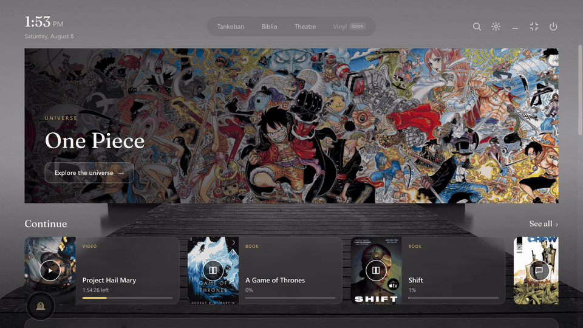
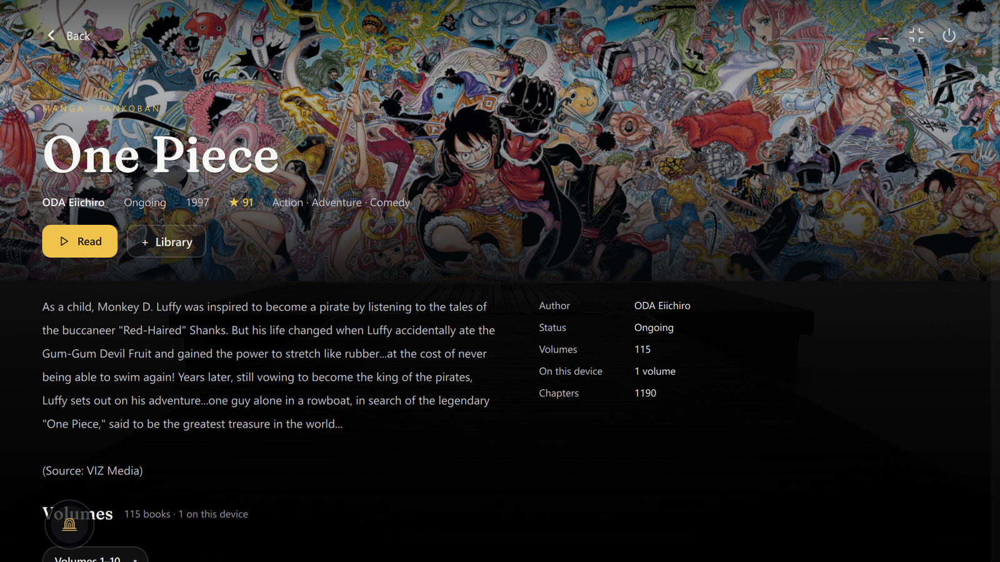
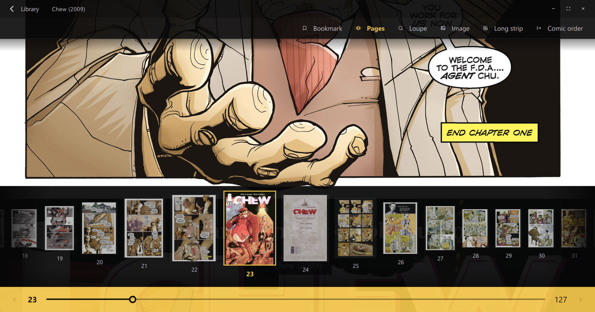
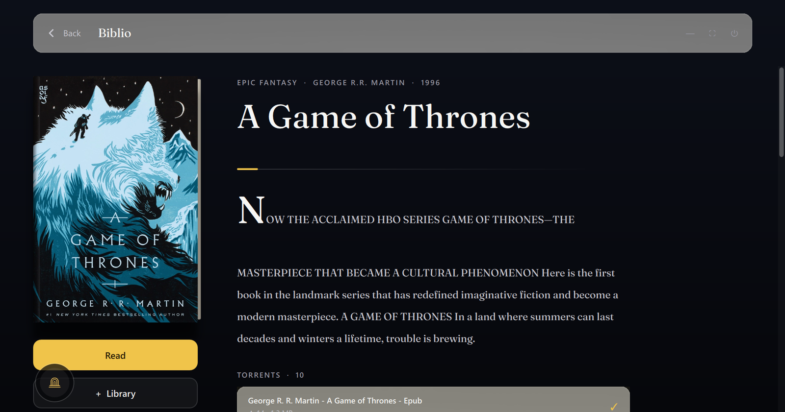
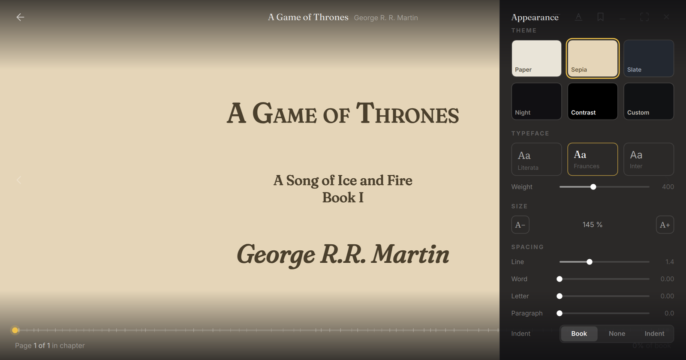
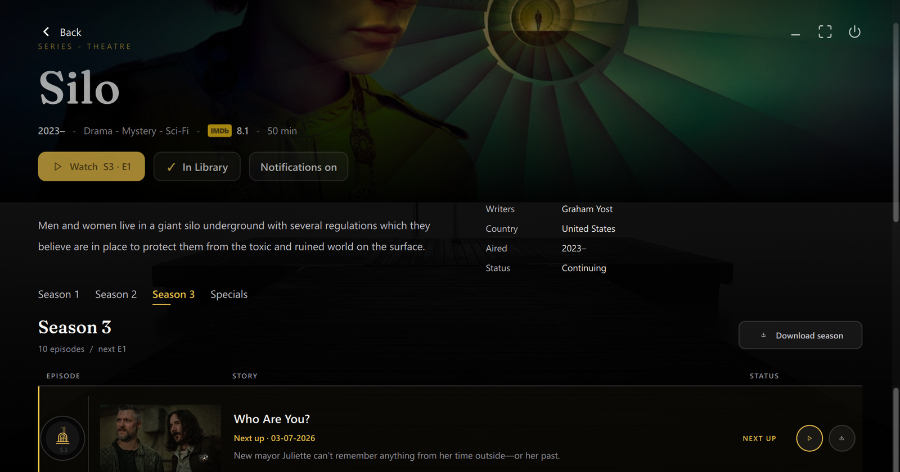
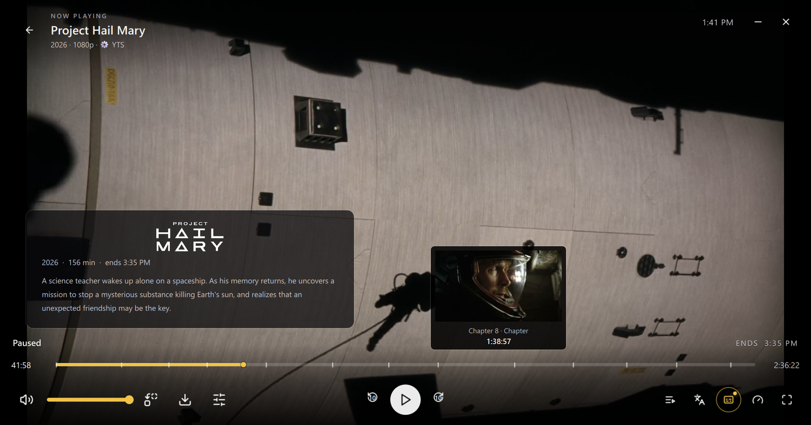
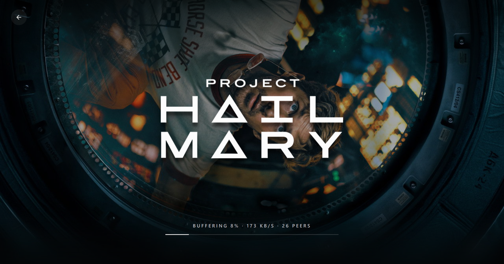

<p align="center">
  
</p>

<h1 align="center">Colosseum</h1>

<p align="center">
  <strong>Manga, comics, books, audiobooks, movies, shows, anime, and local media in one desktop app.</strong>
</p>

<p align="center">
  <a href="https://github.com/kingoftheseas56/Colosseum/releases"></a>
  <a href="https://github.com/kingoftheseas56/Colosseum/releases/tag/v1.1.10"></a>
  <a href="https://github.com/kingoftheseas56/Colosseum/releases/latest"></a>
  <a href="LICENSE"></a>
</p>

<p align="center">
  <a href="https://github.com/kingoftheseas56/Colosseum/actions/workflows/desktop-ci.yml"></a>
  <a href="https://github.com/kingoftheseas56/Colosseum/actions/workflows/code-quality.yml"></a>
</p>

<p align="center">
  
</p>

<p align="center">
  <a href="https://getcolosseum.world/"><strong>Official website</strong></a> &nbsp;|&nbsp;
  <a href="https://getcolosseum.world/#next"><strong>Explore 1.1.9 &amp; Tributes</strong></a> &nbsp;|&nbsp;
  <a href="https://github.com/kingoftheseas56/Colosseum/releases/tag/v1.1.10"><strong>Download 1.1.10</strong></a> &nbsp;|&nbsp;
  <a href="docs/README.md">Docs</a> &nbsp;|&nbsp;
  Source builds: <a href="docs/build/windows.md">Windows</a> &middot;
  <a href="docs/build/macos.md">macOS</a> &middot;
  <a href="docs/build/linux.md">Linux</a> &nbsp;|&nbsp;
  <a href="https://github.com/kingoftheseas56/Colosseum/issues/new?template=bug_report.yml">Report a bug</a> &nbsp;|&nbsp;
  <a href="SUPPORT.md">Support</a> &nbsp;|&nbsp;
  <a href="CONTRIBUTING.md">Contribute</a> &nbsp;|&nbsp;
  <a href="SECURITY.md">Security</a>
</p>

## What Colosseum is

Colosseum is a native Qt desktop app that brings different kinds of media together. Tankoban handles manga and western comics, Biblio handles ebooks and audiobooks, and Theatre handles movies, shows, and anime. Universes connects stories across media through franchise-specific experiences, while Vault indexes files you already have on your machine.

These five worlds share Home, Continue, Collection, Downloads, settings, and open sessions, but each medium keeps its own reader or player. Comics use the comic reader, books use Reader2 with audiobook support, and Theatre uses the mpv-based player. Downloaded media stays local, and Vault does not move the files it indexes.

> [!IMPORTANT]
> **Colosseum 1.1.10 is the current published release**, with installers for Windows 10/11 and Linux amd64. [Download 1.1.10](https://github.com/kingoftheseas56/Colosseum/releases/tag/v1.1.10).
>
> Upgrading to 1.1.10 currently requires a **manual installation**. The full automatic signed-update chain has not yet been qualified end to end. Use the published release assets and checksums.

## What's new in 1.1.10

A few fixes and improvements in this update:

- **Vault:** Fixed a major bug that caused the Vault page to render incorrectly.
- **Linux Accounts:** Linux now has the same account system as Windows.
- **Online Native Add-ons:** New manga sources can now be added without requiring another Colosseum update.
- **Other Fixes:** Added MangaSin as an optional Spanish source and a retry option for videos that fail to open.

[Download 1.1.10](https://github.com/kingoftheseas56/Colosseum/releases/tag/v1.1.10) · [Read the 1.1.10 release notes](https://github.com/kingoftheseas56/Colosseum/releases/tag/v1.1.10)

## What's new in 1.1.9

<p align="center">
  <a href="https://getcolosseum.world/#next"></a>
</p>

- **Universes:** A dedicated fourth world for exploring connected stories across books, comics, films, and series. Franchise collections include One Piece, Star Wars, DCAU, Marvel, and more. One Piece has interactive atlases spanning East Blue, Paradise, New World, and Final Sea.
- **Cloudflare Workers-powered catalogues:** Native catalogue content, Universe definitions, and project-owned artwork can be delivered and updated online without rebuilding the desktop app. Prepared shelves and caching reduce the need to load whole catalogue databases.
- **Tributes:** Bespoke, interactive franchise showcases distinct from the structured Universe pages. Explore [Star Wars](https://getcolosseum.world/tributes/star-wars/), [Cosmere](https://getcolosseum.world/tributes/stormlight/), and [One Piece](https://getcolosseum.world/tributes/one-piece/) on the website.
- **Desktop improvements:** Refined Vault browsing and native Extensions House, fixes for local comic Continue and Reader2 PDF search, plus playback, progress, and Linux packaging improvements.
- **One standard edition:** Local reading, playback, and library use do not require a Colosseum account; accounts are optional.

[Explore the 1.1.9 website and interactive demos](https://getcolosseum.world/#next) · [Read the release announcement](https://github.com/kingoftheseas56/Colosseum/releases/tag/v1.1.9) · [Full release notes](https://getcolosseum.world/releases/v1.1.9)

## Screenshots

<table>
  <tr>
    <td align="center"><br /><sub>Tankoban series, volume view</sub></td>
    <td align="center"><br /><sub>Comic reader</sub></td>
  </tr>
  <tr>
    <td align="center"><br /><sub>Biblio book page</sub></td>
    <td align="center"><br /><sub>Reader themes and typography</sub></td>
  </tr>
  <tr>
    <td align="center"><br /><sub>Theatre series page</sub></td>
    <td align="center"><br /><sub>Native player</sub></td>
  </tr>
  <tr>
    <td colspan="2" align="center"><br /><sub>Cinematic loader</sub></td>
  </tr>
</table>

<!-- VIDEO EMBEDS: drag 01-hero-home.mp4, 02-theatre-discover.mp4, 05-tankoban-discover.mp4
     into this section in the GitHub editor; each becomes a playable embed. -->

## The five worlds

| World | For | Built-in sources |
|---|---|---|
| **Tankoban** | manga and western comics | local/managed MAL + Tankoban catalogues; AniList metadata; Tankoyomi chapter providers; Nyaa volume source (off by default); GetComics + local comic catalog |
| **Biblio** | ebooks and audiobooks | Apple Books + Open Library discovery, LibGen, AudioBookBay |
| **Theatre** | movies, shows, anime | Cinemeta + offline IMDb catalogue, Jikan/AniList/Kitsu; installed Stremio extensions |
| **Universes** | interconnected franchise stories across media | curated cross-media catalogues and online Universe definitions |
| **Vault** | media already on your device | indexed local folders, embedded metadata, and cached artwork |

## Universes

Introduced as Colosseum's fourth world in 1.1.9, Universes are structured, cross-media franchise spaces with curated shelves, banners, categories, and keyboard navigation. They bring related manga, comics, books, films, and shows together rather than separating a franchise by medium. The catalogue includes One Piece, Star Wars, the DC Animated Universe, Marvel, Star Trek, and other collections.

One Piece has interactive East Blue, Paradise, New World, and Final Sea atlases with island markers, arc previews, and sea navigation. Universe definitions and project-owned artwork can receive compatible online updates through the Colosseum content service.

**Tributes are different from Universes.** They are handcrafted, visually distinctive experiences that celebrate individual franchises. The [official website](https://getcolosseum.world/) lets you explore interactive [Star Wars](https://getcolosseum.world/tributes/star-wars/), [Cosmere](https://getcolosseum.world/tributes/stormlight/), and [One Piece](https://getcolosseum.world/tributes/one-piece/) tributes.

## Vault

Vault is Colosseum's library for local files. It is separate from Downloads: Vault indexes folders you choose, while Downloads tracks media acquired by Colosseum's own backends.

The Vault entry stays on Home even before you add a folder. Once you add roots, Colosseum scans them in place and watches confirmed roots for changes. Missing or disconnected roots stay visible as `away`. The Browse view has recent arrivals, folder navigation, search, filters, and identity correction for files that were matched badly.

Artwork comes from the media when possible. Books and comics can reuse embedded covers, recognized movies and shows can use locally cached posters, and local video can get persistent ffmpeg frame grabs. Once artwork has been acquired, Vault can keep showing it offline.

Vault also tries to keep identity and progress when files move or appear as copies. When a likely copy needs a decision, you can keep the existing state or treat the file as separate. Supported books, comics, manga, and video open through the same readers and player used elsewhere in Colosseum. The Downloads tree can also appear as a synthetic Vault root without moving or deleting the underlying download data.

## Readers and playback

- **Theatre player:** MpvQt/libmpv under a fullscreen QML surface. It has resume, warm minimize, audio and subtitle selection, online subtitles, track delays, speed controls, fill and aspect controls, PiP, skip segments, episode queues, source failover, Up Next, A-B loop, sleep timer, captures, GIF tools, chapter markers, loudness normalization, and ffmpeg-backed seek thumbnails.
- **Player 2:** an experimental D3D11/FFmpeg engine behind an opt-in build and boot gate. It is not the default player.
- **Comic reader:** shared by Tankoban volumes and western comic editions. It supports long strip, single and double page, MangaPlus-style pairing, LTR/RTL direction, fit and zoom, wide-page splitting, prefetch, page grids, spread knowledge, scrub navigation, and exact resume.
- **Reader2:** QML chrome over a least-privilege WebEngine paper. It has contents, bookmarks, annotations, search, footnotes, typography, themes, keyboard navigation, and minimizable sessions. Audiobook playback and Follow my reading live inside its Audio surface.

## Watch Party

Watch Party lives inside Player 1. Creating or joining a room uses the hosted protocol-v3 relay by default, so normal use does not require an endpoint setting. The taskbar has a Join action, and the player owns room controls, participant state, chat, reactions, reconnect behavior, host/shared control, source readiness, sync state, and timeline commands.

Torrent portability is strict: the room proves an exact torrent with `infoHash + fileIdx` so another participant can fetch the same source. Generic direct-stream URLs are not eligible.

`COLOSSEUM_WATCH_PARTY_URL` is still available for self-hosting and testing. The repository includes the Cloudflare Worker and Durable Object relay plus deployment notes in [`server/watchparty-relay/DEPLOYMENT.md`](server/watchparty-relay/DEPLOYMENT.md). Guest room flows work without an account. Public signed-in hosting still depends on account-service bearer authority being wired into the hosted relay. Final in-app synced-playback acceptance remains a field-testing boundary.

## Extensions

Colosseum's extension system is Stremio-compatible. Sources controls world-aware source chains, Browse handles curated and community discovery plus manifest preview, and Installed manages ordering, configuration, enable/disable state, and removal.

Theatre extensions can return torrent or direct HTTP streams. Direct results can carry provider request headers into the player, and configured manifests can hand setup or authentication back to the provider. Colosseum does not store a provider's debrid credentials as its own account state.

Tankoban and Biblio can use compatible extension catalogues for discovery, while their download and acquisition paths remain native to those worlds.

**NoTorrent** ships enabled by default in Theatre and can be removed like any other extension. Explicit-content manifests are hidden by default and follow the same global **Explicit Content** preference whether they arrive through direct installation or community Browse.

## Downloads, Collection, and sessions

- **Downloads** collects Tankoban volumes, comics, LibGen ebooks, and Theatre video in one taskbar surface. Open, retry, pause, cancel, and delete actions go back to the backend that owns the item.
- **Collection** is a manual library shared by all three worlds. It is separate from progress and from whether the media exists locally.
- **Sessions** are open books, comic or manga readers, and video surfaces that you can switch from the taskbar. Audiobook playback stays inside its book session.

## Accounts and sync

Colosseum 1.1.10 remains one standard edition with optional accounts. It contains the desktop account client and uses an app-owned account-service endpoint by default. `COLOSSEUM_ACCOUNT_SERVICE_URL` can override it at runtime, and source builds can provide `-DCOLOSSEUM_ACCOUNT_SERVICE_URL=https://<host>` when they need a different service. The Go service lives at [`server/account-service`](server/account-service), with its deployment contract in [`server/account-service/DEPLOYMENT.md`](server/account-service/DEPLOYMENT.md).

An account is optional for local use. Vault, local media, readers, playback, and the rest of the on-device library still work without one. Hosted account features depend on the service being reachable; the repository does not treat provider-side deployment state as something the desktop build can prove. For local account testing, run [`tests/mock-account-service`](tests/mock-account-service) and point `COLOSSEUM_ACCOUNT_SERVICE_URL` at it.

When the service is available, Account Centre has Profile, Your Colosseum, Security, Devices, Recovery, and Data & privacy pages. Profile handles the account name and built-in avatar. Security owns new-device protection, pending sign-in approvals, password changes, and sign-out-everywhere. Devices can refresh and revoke trusted devices. Recovery can replace the recovery key without exposing it in normal page state.

Portable sync covers Collection, Continue/progress, ordinary history, and profile preferences. Machine-specific paths, downloaded or local media files, window state, search history, and the raw Your Colosseum activity ledger stay local. Data & privacy can clear local search and activity history; its policy switches, data export, and account-deletion flow still do not have authoritative service wiring.

## Development on `master`

Source builds on `master` can differ from the published 1.1.10 installers.

## Wallpapers

Each world can keep its own wallpaper. Colosseum ships Noir Flow and Low Poly as animated shaders, Aurora Flow adapted from an LGPL KDE Plasma wallpaper, and the Twilight, Ember, and Mint mesh-gradient stills. There is also a curated KDE Plasma still shelf and Wallhaven search. Animated scenes freeze while immersive media owns the screen.

## Tech stack

Qt 6 (Quick/QML, WebEngine, SQL, Concurrent) · C++ · MpvQt + libmpv · FFmpeg ·
libtorrent-rasterbar · SQLite catalogues · Stremio-compatible extension protocol.

QML handles presentation. Native C++ owns most durable state, files, catalogues, readers, playback engines, torrent transport, WebEngine bridges, downloads, Vault indexing, accounts/sync, and system integration.

## Code quality and security

Every push runs the project's desktop and code-quality checks, including:

- CodeQL across C/C++ and the Python, JavaScript, and GitHub Actions code.
- clang-tidy on native C++.
- AddressSanitizer coverage for the app and lifetime/ownership harnesses.
- Coverage-guided fuzzing for untrusted-input parsers such as CBZ/archive handling, Watch Party protocol parsing, and update manifests.
- Dependency checks for bundled and service dependencies.

See [SECURITY.md](SECURITY.md) to report a vulnerability.

## Install

### Windows installer

Download [`Colosseum-1.1.10-setup.exe`](https://github.com/kingoftheseas56/Colosseum/releases/download/v1.1.10/Colosseum-1.1.10-setup.exe) from the [v1.1.10 release](https://github.com/kingoftheseas56/Colosseum/releases/tag/v1.1.10). Close Colosseum and run the installer. Windows 10/11 installation is per-user and does not require administrator access.

**Upgrading to 1.1.10 is manual.** Versions 1.1.5 and earlier also require a manual install because the 1.1.6 update-signing trust root changed. Colosseum uses a first-party update feed with signed update validation, but full end-to-end automatic-update qualification is still outstanding. Do not rely on automatic updating for this upgrade.

The release includes `SHA256SUMS`, an update manifest, and its production Ed25519 signature.

### Linux installer

Download [`Colosseum-1.1.10-linux-amd64-notices.deb`](https://github.com/kingoftheseas56/Colosseum/releases/download/v1.1.10/Colosseum-1.1.10-linux-amd64-notices.deb) from the same release. For an Ubuntu 24.04 amd64 system, install the package with:

```sh
sudo apt install ./Colosseum-1.1.10-linux-amd64-notices.deb
```

This is one directly installable Debian package with third-party notices included. Linux updates are manual. Ubuntu 24.04 amd64 is the qualified environment; other distributions and hardware have not been universally qualified. Use `LINUX-SHA256SUMS` to verify the download.

### Build from source

The 1.1.10 release provides Windows and Linux installers. Source-build guides are maintained for Windows, macOS, and Linux; macOS does not have a 1.1.10 installer. The Linux package is qualified on Ubuntu 24.04 amd64, and direct trackers are Windows-only for now.

Windows builds use Visual Studio 2022 C++ Build Tools, CMake/Ninja, Qt 6.11.1 MSVC 2022 64-bit, MpvQt/libmpv, and libtorrent/Boost/OpenSSL. Pass your dependency locations explicitly when configuring the build.

- **[Build Colosseum on Windows](docs/build/windows.md)**
- **[Build Colosseum on macOS](docs/build/macos.md)**
- **[Build Colosseum on Linux](docs/build/linux.md)**

Player 2 remains an opt-in experimental build path. MpvQt/libmpv is the default player.

### Development verification

The repository includes Lanista UI journeys and the Night Watch/Guardian verification pipeline. Night Watch collects failed journeys and quality signals. Guardian is document-only: it may reproduce, triage, diagnose, and write a bug record, but it does not merge repairs into `master` on its own.

## First run

1. Launch Colosseum. It opens fullscreen on Home.
2. Pick Tankoban, Biblio, or Theatre to browse a medium, or open Universes for cross-media franchise collections.
3. Open a series, book, or title. Read and Watch open media immediately when the source is ready; download actions send media to Downloads for offline use.
4. Add folders to Vault if you want Colosseum to index media already on your machine without moving it.
5. Anything you start can appear in Continue, and open readers or players stay available as taskbar sessions.
6. Extensions, wallpapers, preferences, account access, and updates live in the shell controls.

## Known boundaries

- Issues reported in 1.1.9 included comics loading speed/alignment and unexpected Vault visibility during One Piece tribute navigation. Their status in 1.1.10 has not been re-qualified.
- Linux updates are currently manual, and the full automatic signed-update flow has not been qualified end to end.
- Home does not have one cross-world search yet. Search is per world.
- After dismissing the Tankoban volume sources picker, volume cards can remain unresponsive for a few seconds before recovering.
- Tankoban and Biblio can use compatible extension catalogues for discovery, but their native acquisition paths are not generic Stremio stream consumers. Theatre handles generic torrent and direct-stream playback from compatible add-ons.
- Hosted account features depend on the account service being reachable. Local media use does not.
- Watch Party can share exact torrent identity, but generic direct URLs are deliberately excluded. Public signed-in hosting also depends on bearer-authority wiring in the hosted relay.
- The calendar implementation exists in the repository but has no live navigation route.
- Player 2 is opt-in and Windows/D3D11-oriented. MpvQt/libmpv remains the default.
- Feria and Vinyl are not available in 1.1.10. Their development source does not make them part of this release.
- Catalogue databases such as `data/comics_catalog.db`, `data/mal_catalog.db`, `data/tankoban_catalog.db`, and `data/imdb_catalog.db` are deployment artifacts and stay out of normal Git source. Source builds prefer local copies and otherwise use the catalogue vault to fetch published databases into AppData.
- Casting and live TV/DVR are still under development.

## How the project is built

Transport is shared where it makes sense, while each medium keeps its own rules. Collection and progress are separate concepts. Vault keeps identity and metadata for local files without taking ownership of those files. Matching is conservative, so uncertain results are left alone.

The UI uses real empty states and fallbacks. Vault's Browse card layout is adapted from Jellyfin's library view: poster grids, near-square corners, centered one-line titles, dim fact lines, circular corner indicators, hover reveal, and 16:9 episode cards.

## Repository layout

```text
Colosseum/
├── qml/         Shell, worlds, media surfaces, components, providers
├── native/      C++ launcher and native services
├── resources/   Reader assets and vendored runtime resources
├── data/        Pipeline-deployed, gitignored SQLite catalogs
├── scripts/     Catalogue bake, installer, verification, maintenance
├── assets/      Icons, extension logos, fonts, wallpaper assets
├── docs/        Architecture, research, mockups, specifications, release notes
├── tests/       Contract, harness, source, journey, and smoke tests
├── archive/     Retired implementations and preserved universe pages
├── dev.bat      Standard Windows QML live-reload loop
└── dist/        Built installers
```

## Contributing and project help

Bug reports and focused pull requests are welcome. For larger changes, open an issue first so the direction can be discussed before implementation.

- [Contributing guide](CONTRIBUTING.md)
- [Bug reports and feature requests](https://github.com/kingoftheseas56/Colosseum/issues/new/choose)
- [Support and troubleshooting](SUPPORT.md)
- [Security policy](SECURITY.md)
- [Code of Conduct](CODE_OF_CONDUCT.md)

## License

[MIT](LICENSE) © 2026 Hemanth Ganneni

> [!NOTE]
> Colosseum is a client and does not host media. External APIs, sites, extensions, indexers, datasets, and scrapers are independent services and can change or disappear. Use sources and content only where you have the right to access them.
