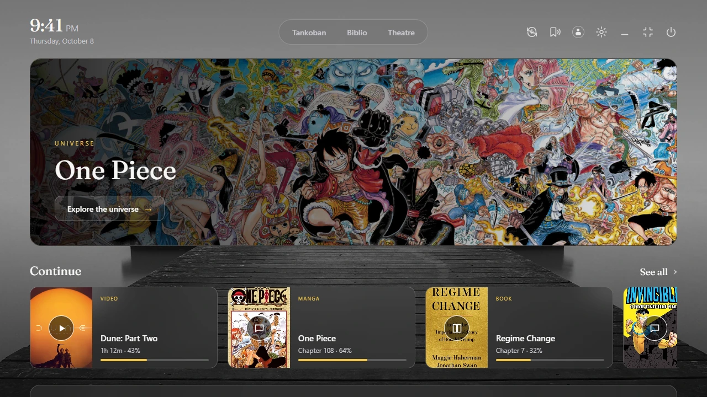
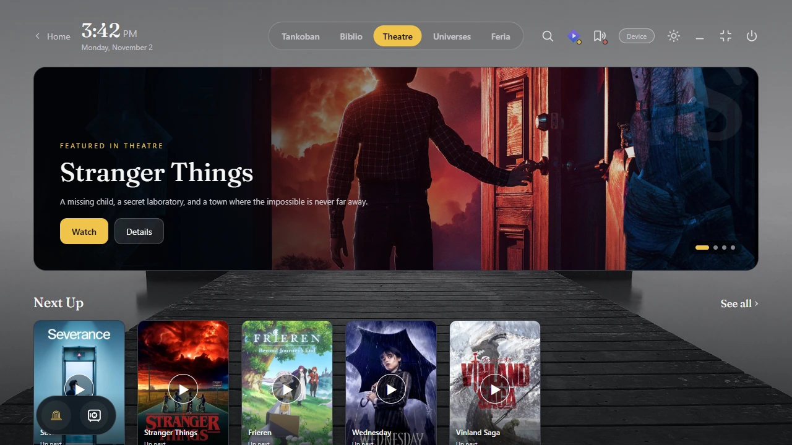
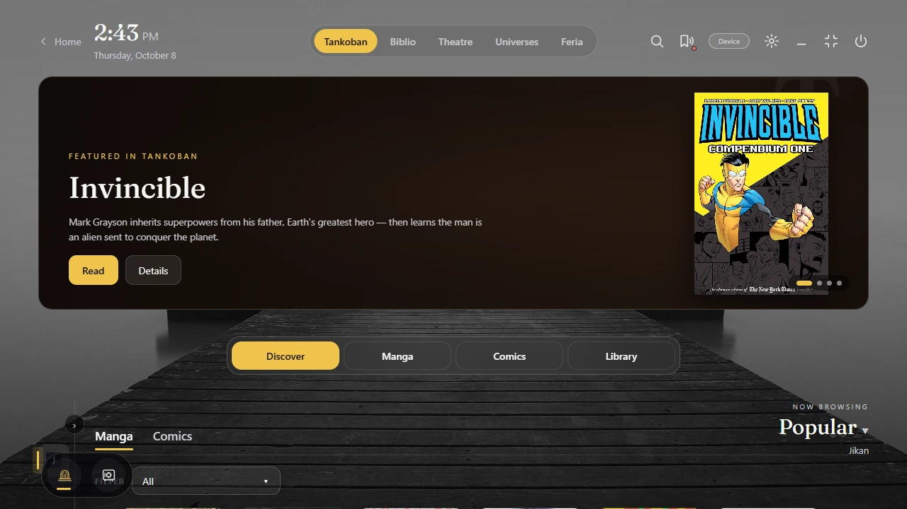
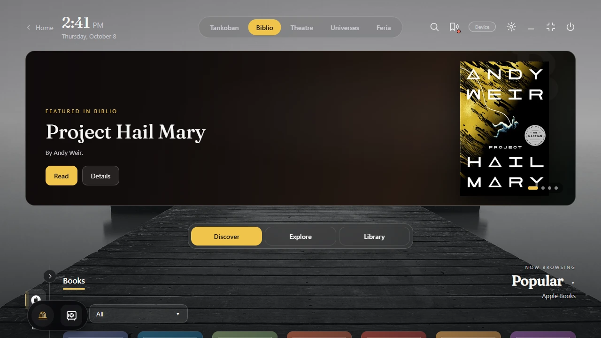
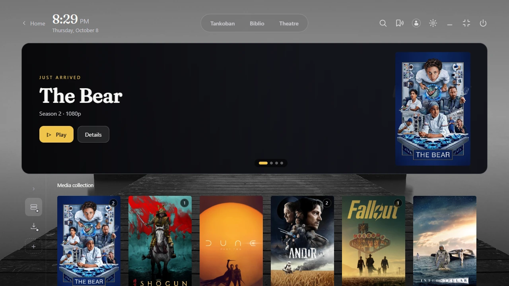
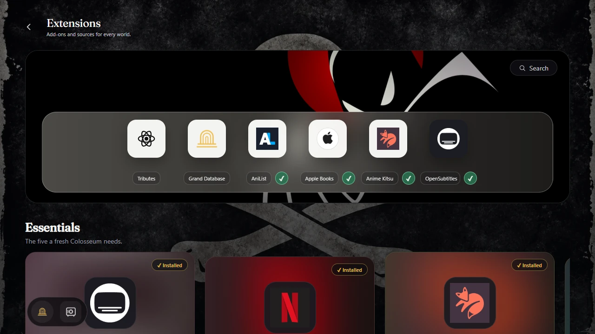
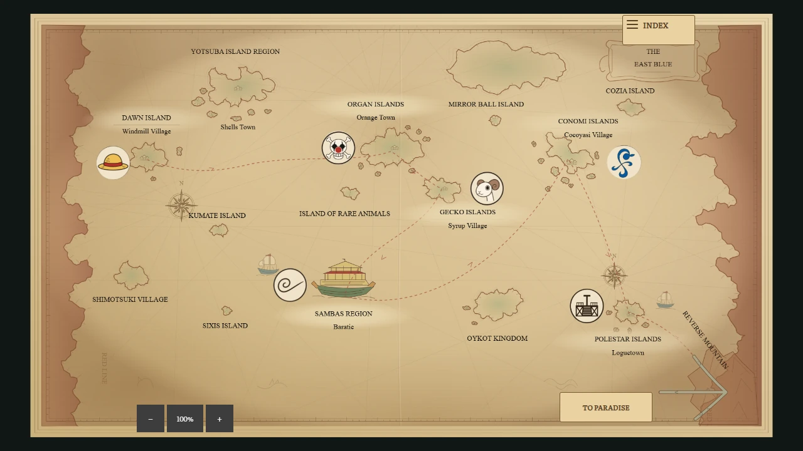

  
  

<strong>One media app for all art.</strong>

  
  
  
  

  
  
  
  

  
  

  
  

  
   
  Home · Click the image to explore the interactive website preview

Colosseum is an app that brings worlds of media together: **Theatre** is the world for movies, TV shows, and anime, and has a video player to bring them to life; **Tankoban** is for manga and comics, with a comic reader to cherish them; **Biblio** is for books and audiobooks, along with a book reader to get lost in the vast depths of literature; **Universes** is the world of curated catalogues, bringing together media of every kind from your favorite franchises into a singular entity, a consumable Wikipedia list made just for you; and **Vault** is the world that turns your homegrown collection of media into an indexed and organized library, so you can explore those familiar files afresh.

All these wildly different mediums, their rich catalogues, sources, readers, and players come together as **one living, breathing media environment.**

## Explore Colosseum

<table>
  <tr>
    <td width="50%" align="center" valign="top">
      
       <strong>Theatre</strong> Movies, shows, and anime
    </td>
    <td width="50%" align="center" valign="top">
      
       <strong>Tankoban</strong> Manga, manhwa, and comics
    </td>
  </tr>
  <tr>
    <td align="center" valign="top">
      
       <strong>Biblio</strong> Books and audiobooks
    </td>
    <td align="center" valign="top">
      
       <strong>Vault</strong> Your own local media
    </td>
  </tr>
  <tr>
    <td align="center" valign="top">
      
       <strong>Extensions</strong> Discover and manage add-ons
    </td>
    <td align="center" valign="top">
      
       <strong>Tributes</strong> Handcrafted interactive franchise experiences
    </td>
  </tr>
</table>

## Future plans

Colosseum is still growing. **Vinyl** is a planned world for music, with songs, albums, artists, and discovery. **Feria** is our plan to bring the websites people already use into the same media environment.

**Feria Mode comes first.** Streaming, music, and reading websites will open as Feria sessions, but the goal isn't to pin ordinary websites and call them apps. We're planning purpose-built sidebars, extensions, and improvements around each service's pain points, with an app-style launcher in the Colosseum taskbar. YouTube, Netflix, Prime Video, Disney+, Crunchyroll, and other services are among the experiences we want to explore.

**A full Feria Browser comes later.** That's a different standard: it needs to hold its own as an everyday browser against established options like Chrome, not ship as a novelty just because we can embed web pages.

**Help shape Feria:** What frustrates you about the website versions of your favorite services? Which extensions help, and what problems remain unsolved? [Share Netflix website feedback](https://github.com/kingoftheseas56/Colosseum/discussions/37) · [Follow Feria development](https://github.com/kingoftheseas56/Colosseum/discussions/36).

## Get Colosseum 1.3.0

| Platform | Download |
| --- | --- |
| **Windows 10/11** | [Installer (.exe)](https://github.com/kingoftheseas56/Colosseum/releases/download/v1.3.0/Colosseum-1.3.0-setup.exe) |
| **Linux (amd64)** | [Debian package (.deb)](https://github.com/kingoftheseas56/Colosseum/releases/download/v1.3.0/Colosseum-1.3.0-linux-amd64.deb) |
| **macOS (Apple Silicon, M1+)** | [Preview disk image (.dmg)](https://github.com/kingoftheseas56/Colosseum/releases/download/v1.3.0/Colosseum-1.3.0-macOS-arm64.dmg) |

[All release files and SHA-256 checksums](https://github.com/kingoftheseas56/Colosseum/releases/tag/v1.3.0) · [1.3.0 release notes](docs/release-notes/v1.3.0.md)

**Android:** [1.3.0 Beta 1](https://github.com/kingoftheseas56/Colosseum/releases/tag/android-v1.3.0-beta.1) remains a separate release for Android 9+ ARM64. This desktop release does not replace it.

**macOS preview:** Requires macOS 26.1 or newer and Apple Silicon. The DMG is ad-hoc signed and not notarized; see the [release instructions and checksum](https://github.com/kingoftheseas56/Colosseum/releases/tag/v1.3.0) before installing.

## Build and contribute

[Build on Windows](docs/build/windows.md) · [Linux](docs/build/linux.md) · [macOS](docs/build/macos.md) · [Contributing](CONTRIBUTING.md) · [Documentation](docs/README.md) · [Report an issue](https://github.com/kingoftheseas56/Colosseum/issues/new/choose)

**Notes:** The Linux package targets Ubuntu 24.04 and Debian 13 amd64 and uses manual updates. Vinyl and Feria are not available in the 1.3.0 installers. Colosseum is a client and does not host media; external sources are independent services.

[Security](SECURITY.md) · [MIT License](LICENSE) © 2026 Hemanth Ganneni
