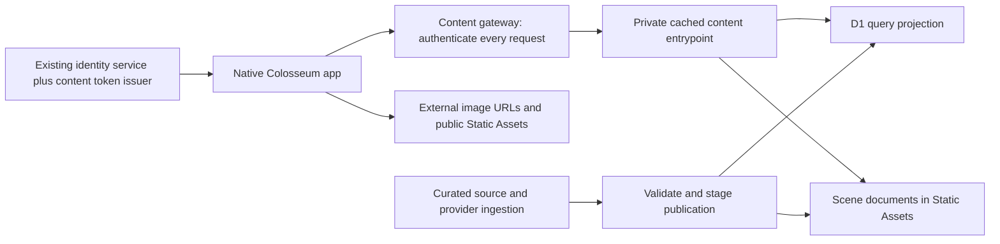

# Colosseum content API: infrastructure decision and action plan

Research date: 14 October 2026. Status: recommended architecture; not provisioned or runtime-qualified.

**Recommendation under the final constraints: Cloudflare Workers Free + D1 Free for the content API, URL references for externally hosted assets, and Workers Static Assets for Colosseum-owned artwork and scene documents. Do not provision R2 for the initial service.** This replaces the earlier paid-Workers/R2 recommendation. Keep Supabase Free as a query-store comparison if D1's import or query limits prove unsuitable; it is not an automatic migration or paid fallback.

The user's constraints are decisive: only free services; no GitHub REST API dependency; only Colosseum apps initially; all catalogue, Universe and Tribute content served through APIs; no client database downloads or post-release content-pack installation. Asset records may contain URLs. Reading an image or JSON response transfers bytes normally, but never triggers a dataset sync or package installation. The native app owns rendering and interaction. User library, history and progress retain their existing ownership. API access is controlled; externally hosted images and our free static images are public URL resources, not protected media.

## Evidence from this checkout

Inspected source at HEAD `a4ed0f275e36bec430512444583ca62e787d8f3e`, plus read-only inspection of current data files. The checkout contains unrelated changes; they were not changed for this research. Counts below describe the working directory, including untracked assets, not an approved publication inventory.

| Surface | Observed size / records | Implication |
|---|---|---|
| IMDb | 21,528,576 bytes; 61,585 titles | Small enough to benchmark directly; not a complete global IMDb corpus |
| MAL | 41,381,888 bytes; 20,000 anime and 20,000 manga | Preserve medium and provider IDs; measure search and facet queries |
| Comics | 98,865,152 bytes; 22,710 series, 1,134 curated series, 398,427 mirror rows | Distinguish catalogue facts from source-resolution data; do not expose every table automatically |
| Tankoban | 2,850,816 bytes; 10,000 series, 28,839 volume records | Preserve volume synthesis and overlay behavior |
| Four databases combined | 164,626,432 bytes, approximately 165 MB | Capacity is not today's primary constraint |
| `assets/universes` | 146 files; 160,999,983 bytes | Asset optimization and lazy delivery matter immediately |
| Largest observed Universe asset | 8,789,112-byte PNG | Serving originals to every card would waste bandwidth and decode memory |

Relevant existing owners:

- `native/engine/CatalogVaultClient.*`: GitHub-release database download/update path; retire it for catalogue service delivery.
- `native/engine/{Imdb,Mal,Comics,Tankoban}Catalog.*`: synchronous SQLite reads and catalogue semantics; convert their UI seams to asynchronous service requests.
- `native/engine/BiblioCatalog.*` and `BiblioCatalogStore.*`: provider ingestion, ranking, provenance and snapshot semantics; migrate shared catalogue processing server-side rather than creating conflicting rules.
- `qml/Universes.js`, `qml/UniverseExtApi.js`, `assets/universes/*.json`: curation, extension identities and current payload validation. The existing payload cache assumes immutable bundled content.
- `qml/Main.qml`: separate bespoke Tribute and structured Universe routes. Preserve both.
- `native/engine/ColosseumTitleIdentityRegistry.*`: existing canonical `ct1:` identity and alias behavior. Do not mint competing identities.
- `server/account-service`: Go/PostgreSQL service exists in source. Current access tokens are opaque: `AuthenticateAccessToken` hashes the token and queries sessions/accounts/devices. A locally verifiable content token needs an explicit exchange/issuer addition. Existing source does not prove available production capacity.

Read-only `EXPLAIN QUERY PLAN` checks using Python's local SQLite showed `SCAN title` and a temporary ordering B-tree for the IMDb prefix-search predicate, and `SCAN manga` for the manga dual-title predicate. A movie rating shelf used `title_type_rating`. These are diagnostic query plans, not D1 latency or concurrency benchmarks. Imports must not blindly preserve the existing search access paths.

## Infrastructure comparison

| Option | Fit | Decision |
|---|---|---|
| Workers Free + D1 Free + asset URLs + Static Assets | Free catalogue API with hard query/request limits; direct images avoid Worker invocation | Preferred candidate under the current constraints |
| R2 + Workers + D1 | Useful object store, but R2 charges beyond its free allocation | Exclude from initial provisioning; no verified zero-dollar hard cap |
| Separate Go/PostgreSQL catalogue service | Familiar code stack, but no verified free hosting/capacity | Not an assumed free fallback |
| Bunny Storage/CDN + query backend | Dedicated asset delivery with minimum/payment requirements | Exclude under free-only constraint |
| S3 + CloudFront + query backend | A free delivery tier exists; query/backend and overage boundaries still need separate proof | No advantage demonstrated over the selected free stack |
| Supabase Free PostgreSQL | 500 MB database; no daily D1-style row-write allowance, but monthly egress and inactivity limits | Compare only if D1 qualification fails; not the image origin |
| R2 objects alone | Works for fixed documents and artwork, not arbitrary catalogue filtering and search | Reject as the complete backend |

R2 Standard lists $0.015/GB-month, metered object operations and no R2 internet-egress charge. Its free allocation includes 10 GB-month, 1 million Class A and 10 million Class B operations monthly. Active delivery should use Standard rather than Infrequent Access, which has retrieval charges and minimum retention. [R2 pricing](https://developers.cloudflare.com/r2/pricing/).

Bunny's Standard CDN lists $0.01/GB in Europe/North America and $0.03/GB in Asia/Oceania, with a $1 monthly minimum. At 1 TB delivered entirely in Asia/Oceania, that is about $30 CDN bandwidth before storage and the API backend. Its Volume network has a different price/performance offering, so Standard rates are not a claim that Bunny is always more expensive. [Bunny pricing](https://bunny.net/pricing/).

AWS now offers CloudFront flat-rate plans, so an old comparison based only on expensive per-GB egress would be misleading. The current page lists a $15/month Pro plan with 10 million requests and 50 TB transfer allowance. A query backend remains separate; sustained excess can affect delivery under the plan's usage policy. [CloudFront pricing](https://aws.amazon.com/cloudfront/pricing/), [usage policy](https://docs.aws.amazon.com/AmazonCloudFront/latest/DeveloperGuide/flat-rate-pricing-plan.html).

Supabase Free offers a 500 MB database, 5 GB ordinary egress, 5 GB cached egress and 1 GB file storage, with two active projects and inactivity pausing after one week. It is a possible query-store comparison without replacing Colosseum identity. Its monthly egress makes it unattractive as the main image host. SQLite file size is not proof that the converted PostgreSQL tables and indexes fit. [Supabase pricing](https://supabase.com/pricing).

This recommendation is based on product fit, current scale and documented pricing. No cross-provider latency test or account-level capacity audit has been performed; R2 has not been proven the fastest provider.

## Metadata sources: Wikidata plus specialist providers

Asset URLs solve artwork delivery; they do not supply a metadata library. Add a shared enrichment layer above the existing catalogues. Use Wikidata as the preferred cross-media relationship and external-ID source, while retaining medium-specific providers and Colosseum curation. MusicBrainz is a music specialist, not a replacement for books, films, manga or comics. This is an architectural recommendation; no representative coverage/match-quality audit has yet been run.

| Layer | Role in Colosseum |
|---|---|
| Existing Colosseum canonical IDs | Stable identity for saved library items, progress and routing |
| Wikidata QIDs | External aliases; creators, relationships, dates, languages and other structured facts where present |
| Existing screen/anime/manga/comics providers | Medium-specific metadata and episode/volume/issue detail; continued use subject to each source's permitted access/reuse |
| Open Library and existing book providers | Work/edition/author/ISBN facts; preserve existing Biblio canonicalization and field precedence |
| YouTube Music (Vinyl) | Primary live music catalogue; retain provider browse/video IDs and selected release context |
| MusicBrainz | Optional Vinyl identity/metadata enrichment; never a prerequisite for YouTube browsing or playback |
| Colosseum curation | Universe membership, canon choices, reading/watch order, Tribute narrative and presentation |

Wikidata's structured data is CC0 and accessible through entity retrieval, search and SPARQL interfaces. Use known-ID retrieval through the documented Action API (`wbgetentities`) or entity JSON; use `wbsearchentities` only to generate candidates. Bounded external-ID queries can help establish mappings. Do not call a broad SPARQL traversal from each catalogue-card request. Observe meaningful User-Agent identification, bounded concurrency, `maxlag` where applicable and Retry-After. [Wikidata access guidance](https://www.wikidata.org/wiki/Wikidata:Data_access), [API search and discovery](https://www.mediawiki.org/wiki/API:Search_and_discovery), [Wikimedia rate limits](https://www.mediawiki.org/wiki/Wikimedia_APIs/Rate_limits).

Do not assume Wikidata contains a complete franchise chronology, every episode/edition, rich plot prose or a usable poster for every work. Missing facts remain missing, and providers can disagree. A franchise, original work, adaptation, edition and soundtrack are different entity types. Preserve existing `ct1:` IDs; attach verified QIDs/MBIDs/provider identifiers as aliases rather than replacing identity. Exact identifier plus compatible entity type is the preferred match. Title-only results remain unresolved until corroborated by year, creator, medium or an explicit curated mapping. A book adaptation relationship is not identity equivalence.

Store provenance per field/relationship: source entity, source revision or observation time, language, qualifiers, matching basis and publication status. Retain multiple dated/territorial release facts rather than collapsing them into one arbitrary date. Curated canon/order overrides automatic relationship ordering. Wikidata's data license does not automatically cover a linked Wikipedia article or an image: preserve the actual source and attribution/license of text and assets separately. [Wikidata licensing](https://www.wikidata.org/wiki/Wikidata:Licensing).

MusicBrainz's public API documents a maximum of one request per second per client application, meaningful User-Agent identification and free non-commercial use. Its core database is CC0, while supplementary data has different terms; cover art is a separate source. Therefore only activate a MusicBrainz adapter for needed music records after checking applicable usage and fields. Do not assume that a free-to-download Colosseum binary alone establishes non-commercial eligibility. [MusicBrainz API](https://musicbrainz.org/doc/MusicBrainz_API), [data licensing](https://musicbrainz.org/doc/About/Data_License). Direct documentation fetches returned 429 during this research; indexed official documentation supplied these details, not a live API integration test.

Free-tier implementation: the existing local publisher runs bounded enrichment jobs, beginning with the current Universe roster and frequently used catalogue works. It fetches provider records once, validates mappings, writes only changed approved facts into the D1 query projection, and emits larger immutable detail documents into the internal static-content area. Batch detail records where necessary to stay below the 20,000-file cap; never create one hosted file for every external entity by default. The API returns a single Colosseum response with provenance/freshness. Cached base metadata remains usable when enrichment is unavailable; an app detail request does not trigger an unbounded multi-provider fan-out.

Keep enrichment cursors, failed-match records and raw evidence locally with the publisher. Apply provider-specific budgets and the D1 daily write budget; a per-isolate timer is not a global API rate limiter. Proposed refresh defaults are 30 days for established facts and shorter, explicitly budgeted intervals for ongoing works. Only changed facts consume publication writes. Never mirror all of Wikidata or MusicBrainz into D1 Free. Access to a large external knowledge base does not require owning a full copy.

Before implementation, qualify a 100-record sample spanning One Piece, Star Wars, DCAU and Cosmere, plus books/editions, ambiguous same-name works and relevant soundtrack examples. Record entity coverage, match precision, field completeness, API requests, storage bytes and write amplification. Include deliberately wrong film/book/edition candidates. The gate is zero incorrect accepted identity merges in the reviewed sample; missing coverage must have an explicit specialist-source or curated fallback. The sample is a proposed task, not completed evidence. Full new-title discovery beyond the seeded catalogue requires a separately budgeted provider-search adapter; cached enrichment alone does not constitute a complete worldwide catalogue.

## Vinyl Arc 62 integration

Arc 62's later R17/R18 decisions supersede the older MusicBrainz-only baseline: anonymous YouTube Music is the primary catalogue, MusicBrainz supplies optional metadata/identity enrichment, and Vinyl owns history, play counts, taste, Home and recommendations. A Google account is an optional sync adapter. The current Vinyl implementation owner confirms that backend contracts are prototypes and that no new production music database has been selected. Evidence: `Preflight-Architect/arcs/62-vinyl/claude-brainstorm-review-post-wave3/CLAUDE-REVIEW-RESPONSE.md`, R11/R17/R18 and the subsequent algorithm correction; the 2026-10-14 Vinyl gap review; the implementation owner's coordination update in this planning chat. These are research/review artifacts, not operating instructions.

Keep three distinct data paths:

| Path | Owner and API treatment |
|---|---|
| Shared metadata and curated relationships | This content API can publish approved MusicBrainz/Wikidata facts, aliases, credits, soundtrack-to-work relationships and artwork URLs. D1 holds the compact query projection; no full music corpus import is required. |
| Live catalogue and playback resolution | Vinyl's provider adapter supplies YouTube search, releases and track IDs. Resolve expiring audio URLs at playback time; never put them in immutable snapshots or treat an old resolution as current playability. Stable artwork URLs and expiring stream URLs are different classes. |
| Private profile state | Existing Colosseum library/history/preferences/progress owners remain authoritative. Do not create a shared D1 music-library table or new local store merely for enrichment. The first listening slice is inspecting reuse of profile-scoped ProgressStore; this is work in progress, not final adoption. |

The title-registry guidance above applies where that registry already owns identity. Vinyl's direction is `entity kind + canonical UUID`: an MBID where already known, otherwise deterministic UUIDv5 from a defined provider-origin/source-key namespace. Preserve YouTube source mappings and saved UUIDs when later enrichment finds an MB match. Record reversible equivalence/redirect evidence; do not collapse release groups, releases, recordings, videos or musical works by title. Accommodate this identity owner instead of forcing music into the title registry. Namespace/key encoding and cross-registry links require contract qualification before publication.

The implementation owner reports live anonymous search, album browsing and one Opus stream resolution through ytmusicapi/yt-dlp. Those are provider probes, not proof of completed native playback, production deployment or a working Cloudflare-hosted resolver. The first milestone remains search → chosen album → real sound → quit → resume. Full MusicBrainz ingestion / Arc 65 is outside its critical path.

For the eventual service architecture, retain separate catalogue/enrichment/resolver interfaces. Proposed shared API additions are batch music identity lookup and typed cross-media relationships; the native adapter can consume them without a database download. Hosting the live YouTube adapter/resolver on Workers Free is a separate feasibility gate: prove runtime compatibility, provider reachability, request/CPU budgets and playback from the actual client network. A remotely resolved stream URL may not behave like a client-resolved URL. R2 and D1 do not solve that; local Python provider probes do not prove free hosted feasibility. Keep the current local adapter as the development path until that gate is qualified; it does not settle the eventual deployment location.

Vinyl's algorithm work is also reusable direction: use Brainz-style methods and medium-specific evidence to build Colosseum-owned discovery across worlds. Metadata relationships alone cannot supply trending or personalized ranking. Retain timestamps, provenance and confidence for public observations; keep private listening evidence profile-scoped. Do not publish provider charts as if they were Vinyl's own computed lists. Algorithm implementation remains the Vinyl lane's responsibility.

## Proposed serving architecture

Use a dedicated content service, independent of account/profile traffic. Suggested Worker names are `content-api-staging` and `content-api-production`; actual names must be checked before provisioning. Use the free workers.dev hostname initially. An existing domain can be attached later if already available without additional spend. No new domain purchase, Workers Paid upgrade, billable R2 subscription or paid image transformation service is part of this plan.

Route `/v1/*` through the Worker for authentication, query validation and API responses. Route `/assets/*` directly to static files. Configure `run_worker_first` for `/v1/*` and `/_content/*`; reject external requests to `/_content/*`, and access those scene documents internally through the assets binding from approved API routes. Test direct paths, encoded paths, previews and alternate hostnames for bypasses. Apps receive image URLs, never database exports or publishing credentials. [Static Assets routing and binding](https://developers.cloudflare.com/workers/static-assets/binding/).

Workers Static Assets provides free storage and direct asset requests. The Free plan permits 20,000 files per Worker version and 25 MiB per file. The observed local Universe assets fit individually, but the full catalogue's external artwork has not been inventoried. Keep it as URLs rather than assuming every cover can be mirrored into that allowance. Requests which invoke a Worker still count toward its free request limit. [Static Assets billing](https://developers.cloudflare.com/workers/static-assets/billing-and-limitations/), [file limits](https://developers.cloudflare.com/workers/platform/limits/#static-assets).

### Query storage and search

Start with one dedicated D1 database per environment at this scale, with catalogue/revision columns and explicit indexes. Individual Universes do not require separate infrastructure databases. Keep source-specific facts and provider resolution records separate from the common work/alias projection. Build precomputed popular shelves and facet counts; do not calculate global aggregates on every screen request.

Use exact canonical/provider lookup first, then normalized aliases and tested prefix/full-text search. D1 supports FTS5, but a token-search replacement must preserve current title matching, punctuation, language and ranking behavior. Use keyset pagination with stable tie-breakers, bound values and allowlisted sorts/filters. Do not permit raw SQL, unbounded result sizes or an arbitrary URL proxy. [D1 SQL support](https://developers.cloudflare.com/d1/sql-api/sql-statements/).

D1 Free permits 500 MB per database, 5 GB total account storage and 10 databases. Queries execute serially within an individual database instance; size alone does not qualify it. Keep a compact query projection and test exact ID lookup, title/alias search, multi-facet filtering, deep paging, batch facts, book editions and Universe membership. Source snapshots and bulky resolution facts need not all become indexed query rows. [D1 limits](https://developers.cloudflare.com/d1/platform/limits/), [execution constraints](https://developers.cloudflare.com/d1/reference/faq/).

Initial proposed targets: warm JSON p95 <=250 ms from India; uncached JSON p95 <=800 ms; gateway/serialization CPU p95 <=5 ms with no 10 ms Free-plan CPU-limit failures; indexed query duration p95 <=25 ms. These are targets, not results. Run sustained load locally first. Limit remote qualification to an agreed daily budget, initially <=5,000 requests and <=500,000 D1 rows read across staging tests; for example a 25-request/second, 60-second mixed test plus smaller regional probes. If indexing/precomputation and a compact projection fail the free quotas, compare Supabase Free with the same fixtures and include its egress budget. Do not upgrade plans automatically.

D1's free allowance is 5 million rows read and 100,000 rows written per day, shared account-wide. Imports and index creation consume it too. The existing source tables exceed one million rows in aggregate, so a same-day wholesale import is not a valid free-plan assumption. Build a resumable, delta-based importer, count index write amplification and reserve live-service headroom. Initial bootstrap may span multiple days; the publisher must compute and report that schedule from actual projected rows. Stage no more than an initial 50,000 measured row writes per day, adjusted downward for other account usage. Hitting a daily D1 limit stops queries; it is not an automatic paid expansion. [D1 metering and exhaustion](https://developers.cloudflare.com/d1/platform/pricing/), [enforcement](https://developers.cloudflare.com/changelog/post/2026-09-01-d1-free-tier-limit-enforcement/).

Enable D1 read replication only with deliberate Sessions API handling. When activation publishes a new revision, first-primary reads or an activation bookmark must ensure replicas can serve it. Never interpret a lagging replica's missing new row as a permanent 404. [D1 replication and bookmarks](https://developers.cloudflare.com/d1/best-practices/read-replication/).

### Content model and contract

Core records: work, provider alias, edition/episode/volume, universe, membership/order, tribute, scene, asset and publication revision. Maintain existing canonical identity rules; store external numeric identifiers as strings in the wire format. A Tribute references its Universe; both reference common work IDs. Separate catalogue facts from changing provider availability and source resolution.

API v1 includes catalogue cards, paged items, filters, work details, bounded batch lookup, search, Universes, sections, Tribute descriptors, scenes and assets. Every collection has a revision and opaque next cursor. A cursor binds the content revision, normalized filters, sort and final sort tuple; invalid cursors return a defined error. Use an initial default page size of 24 and a maximum of 100.

Response envelope: `schemaVersion`, `revision`, `generatedAt`, `freshness`, `items` or `data`, and `nextCursor`. Errors include a stable code, retryability and request ID. Support conditional GET with ETags. Define 401/403, 404, 409 revision-expired, 429 with Retry-After, and 503 explicitly. A server failure must not masquerade as an empty catalogue.

### Tribute rendering and asset delivery

Extract curation and presentation parameters from JS/QML into validated server documents. Keep native renderer IDs such as `one-piece-atlas-v1`; serve only schema/capability combinations the app supports. Preserve current bespoke appearance, keyboard/controller behavior, reduced motion and title routing. New data and supported scene compositions publish without an app release. New executable behavior requires a compatible app release; no remotely executed QML/JavaScript.

Use an asset registry with `assetId`, `url`, `variants`, `source`, `attribution`, `width`, `height`, `mimeType`, `checkedAt` and an optional fallback asset ID. Store existing stable HTTPS source URLs when reusable; an asset URL is a reference, not a copy or uptime guarantee. Reject expiring signed links, login-only URLs and session-dependent hotlinks as durable catalogue assets. Check redirects, URL health and actual Qt loading on Windows/Android with bounded batches. Do not bulk proxy or mirror every image through the API.

Colosseum-owned assets with no durable hosted URL go to free Static Assets at immutable paths such as `/assets/<hash>/640.webp`. Preserve originals and source manifests locally with a second existing backup copy; serving is independent of that archive. Pre-generate needed variants locally. Test Qt formats on each platform; preserve PNG where needed and do not assume AVIF support. Normalize map hotspot coordinates so resizing preserves alignment. Native image requests fetch public URLs directly and use the existing disk cache; only metadata requests hit the protected API. A missing image gets a local placeholder or a verified alternate URL. Third-party source outages do not erase work metadata.

Fetch overview cards first, then the selected scene and visible assets; cancel abandoned requests. Test static-host HEAD/ETag/304 and ranges where media requires them. Do not promise control of caching, Range or lifetime on third-party URLs. A future animation larger than the 25 MiB file limit needs an optimized or appropriately segmented representation, or another explicitly qualified free host; R2 is not a silent fallback. Only generated variants are advertised.

### Authentication and caching

Reuse the existing account/session owner for signed-in issuance only if that path adds no paid hosting dependency. Add a content-only token exchange rather than treating current opaque tokens as JWTs. A standalone guest content-session path can run on the same free Worker and must not require paid account infrastructure. Proposed leases expire after 30 minutes, contain audience/scope/expiry/key ID and are verified locally at the gateway; reuse the lease across requests and do not poll for renewal while idle. Rotate signing keys with overlap. Logout/revocation prevents renewal; ordinary lease revocation is bounded by expiry unless a separately tested immediate revocation check is added. Include issuance, renewal and verification CPU in free-quota measurements.

Account-free catalogue browsing uses a guest installation registration/renewal path with per-installation and IP limits. Reuse existing installation identity where applicable; an install ID is an identifier, not authentication proof. No shared secret is embedded in the binary. Guest issuance cannot cryptographically prove that all callers are official desktop binaries: the initial objective is controlled app integration and abuse resistance, not unbreakable exclusivity. Core local use does not require this service.

The gateway must execute before every protected API cache hit. Use the established Cache API after authentication initially; cache common catalogue data by revision, locale, visibility, renderer schema and normalized query. Return appropriate private-cache headers so an intermediary cannot bypass access checks. Public image URLs are intentionally outside this authentication boundary. Cloudflare also documents an uncached gateway plus cached internal entrypoint pattern; consider it only after confirming Free-plan availability and measured benefit. [Authenticated cache pattern](https://developers.cloudflare.com/workers/cache/examples/).

The Cache API has per-data-center caches and no automatic tiering; `cache.put` cannot store a 206 response. Use it for JSON responses, while images are fetched directly from their hosts. A warm JSON cache saves database work but does not eliminate the gateway request or its CPU. [Cache API behavior](https://developers.cloudflare.com/workers/runtime-apis/cache/).

Initial cache policy: bootstrap/active revision 30 seconds; revisioned catalogue pages 5 minutes; revisioned scene documents 1 hour; owned immutable static images up to a year. External image cache policy follows its host. Keep 401/403/429/5xx out of the shared API cache. Authenticate protected API requests before cache lookup, including HEAD. Token expiry and revocation tests must cover both cache HIT and MISS.

### Publishing, rollback and recovery

Build a publisher outside the request path, initially runnable locally and in CI. It extracts from explicitly selected source revisions, carries source/attribution and publication eligibility, validates identities/references, generates image variants, and writes an immutable manifest with hashes and row/object counts. Do not upload backups, untracked artwork, provider tokens or entire source tables indiscriminately.

Stage inactive SQL revisions within the daily write allowance. Deploy static assets and scene documents containing both current and candidate revisions, then verify candidate API routes. Activate through a conditional update to a small D1 publication row only after all required files and rows exist. Worker deployments and D1 do not share a transaction; publication completeness is an application invariant. Serialize promotions or compare the previous revision to prevent racing publishers. Existing requests stay pinned to their revision. Updating the server's static deployment is content publishing, not an app update or client content-pack installation.

Rollback selects a retained complete revision. Keep at least two known-good releases within the file/database caps, counting shared objects once and never removing files referenced by supported revisions. Retain existing active assets in every server deployment; old deployment history alone does not guarantee old asset paths remain served. Roll back D1's active pointer before any code/assets rollback that could remove a current revision. Expired cursors restart paging rather than mixing revisions. Third-party URL content cannot be rolled back by Colosseum; use immutable source URLs where available.

Retain canonical exports, import scripts and hash manifests locally, plus a separate existing recovery copy; do not make GitHub Releases or a paid backup bucket necessary. D1 Free provides seven-day Time Travel, but restoration/re-import and reindexing must be tested within free quotas. Current D1 documentation lists SQL export limitations for virtual tables and blocking during export; canonical source plus reproducible FTS indexes is the recovery foundation. [D1 import/export limitations](https://developers.cloudflare.com/d1/best-practices/import-export-data/).

### Client migration and offline behavior

Extend existing native catalogue owners with a shared asynchronous transport and models; QML remains presentation. Add request generations, cancellation, bounded retries/backoff, coalescing and a small visible-content prefetch budget. Avoid synchronous HTTP hidden behind old SQL-returning methods.

Reuse existing HTTP/image cache ownership where possible. Cache previously requested data with bounded eviction; do not silently rebuild a full local catalogue. Preserve enough metadata attached to saved library items for local browsing, identification already performed, history and resume. New catalogue discovery and uncached assets require connectivity. Keep local-library search distinct from remote catalogue search. Test account changes so personalized data cannot leak through shared content caches.

Retire production `CatalogVaultClient` fetching only after all affected catalogue journeys have service replacements. Old installed app versions remain an explicit compatibility issue; this plan does not silently redirect their database URLs to an incompatible JSON API. The new release must have zero catalogue DB/content-pack fetches.

## Free capacity model and operations

The operating budget is $0; the earlier $5-$15 estimates no longer apply. Keep Workers and D1 on Free. Do not enable billable products or automatic upgrades. The provider's hard free limits are the backstop; per-client throttling protects availability. Confirm account-wide quota sharing with existing services before setup.

Workers Free permits 100,000 requests/day and 10 ms CPU per invocation. D1 Free permits 5 million rows read/day and 100,000 rows written/day. Direct Static Assets requests do not invoke the gateway, but protected JSON requests do, even on a cache hit. [Workers limits](https://developers.cloudflare.com/workers/platform/limits/), [D1 pricing](https://developers.cloudflare.com/d1/platform/pricing/).

Illustrative assumptions: two sessions/user/day, 12 API responses/session, one content-session call/session, and 40 direct asset requests/session. At 80% API cache hits and 100 scanned rows per JSON miss, the model is:

| Daily active users | Gateway requests/day | Direct image requests/day | D1 rows read/day, before auth and publication |
|---|---:|---:|---:|
| 1,000 | 26,000 | 80,000 | 480,000 |
| 2,000 | 52,000 | 160,000 | 960,000 |
| 10,000 | 260,000 | 800,000 | 4,800,000 |

These are request-budget examples, not capacity promises. They exclude retries, background requests, quota consumed by other services, URL-health jobs and longer sessions requiring renewal. At the assumed interaction pattern, 10,000 DAU exceeds Workers Free regardless of asset URL savings. At zero JSON cache hits, 1,000 DAU would read 2.4 million D1 rows/day at 100 rows/query. A single unindexed 61,585-row search repeated 82 times can exceed 5 million reads. Fix scans before launch.

Set an initial operating target below 50,000 gateway requests and 2.5 million D1 rows read per day across the available account allocation, leaving room for bursts. Treat 80% consumption as a publication/prefetch reduction threshold; telemetry is not an exact admission-control counter. When a hard quota is reached, show cached results and an honest temporary-unavailability state. Do not weaken authentication or auto-enable payment. Fresh discovery can be unavailable until the quota reset. No free-only design can promise unlimited protected API traffic.

Generate variants and perform ingestion locally. Exclude paid image/video transformation, new paid databases, paid runners and paid backup subscriptions. Measure CPU, query scans, active data size, asset count, latency, cache hit rates and errors. Sample/redact logs. Keep local archives and a tested rollback. Do not create multiple accounts to evade service limits.

## Publishing without GitHub REST

The publisher consumes local files and a selected Git commit, builds schemas/data/images locally, and deploys directly to Cloudflare using Wrangler and scoped Cloudflare credentials. Cloudflare's API remains necessary; GitHub's API does not. Store publication manifests and recovery files locally and in an existing second copy. Source control can use ordinary Git transport or an existing alternate remote; runtime delivery does not use GitHub Releases, release-asset APIs, raw GitHub URLs, GitHub Actions or a GitHub OAuth integration.

Use `wrangler deploy` for Worker/static content and bounded D1 imports for the query projection. No hosted CI is required: a manual publisher on the existing machine is sufficient initially. Pin tool versions and retain deterministic build inputs. A server content deployment updates what the API returns without reinstalling the app. [Direct static publishing](https://developers.cloudflare.com/workers/static-assets/direct-upload/).

## Action plan and acceptance gates

| Step | Concrete work / suggested location | Exit evidence |
|---|---|---|
| 1. Freeze contracts and inventory | OpenAPI, JSON schemas, route/query map and source manifest under a proposed `server/content-api/`; record every current caller and canonical ID rule | Each existing catalogue operation mapped; eligible assets/source ownership known; no automatic inclusion of dirty work |
| 2. Qualify metadata and query fixtures | Read-only exporters, the 100-record metadata coverage/matching sample and query fixtures under proposed `tools/content-publisher/` and `server/content-api/tests/` | No incorrect accepted identity merges in the reviewed sample; provenance and source gaps recorded; query results preserve semantics; unjustified scans removed |
| 3. Local vertical slice | Free Worker gateway, local D1 and Static Assets; one catalogue page plus One Piece overview/one sea and URL-based art | No DB/package client transfer; async loading/cancellation; scene/cursor tests; direct asset requests skip Worker |
| 4. Provision free staging | Confirm Free plans, remaining account quotas, workers.dev hostname; create staging D1/Worker and scoped Cloudflare publisher credentials | No R2 or billable add-on; authenticated cache HIT/MISS, expired token, direct static URL and internal-path bypass probes pass |
| 5. Decide query store with quota-bounded load | Run local load plus small remote/regional probes; quantify import writes and CPU; compare Supabase Free only if needed | Measured latency/scans/CPU fit Free; projected footprint and multi-day bootstrap schedule recorded |
| 6. Build publication lifecycle | Stage candidate data/assets, validate, activate, roll back, restore into empty staging | Failed/partial publication never activates; concurrent publish and replica lag covered; rollback restores complete experience |
| 7. Migrate native catalogue clients | Existing engine owners and QML callers; start IMDb, then MAL/Tankoban/comics, then Biblio ingestion/ranking | Search, filtering, infinite scroll, work routing, local-library behavior and provider-outage cases pass per domain |
| 8. Migrate Universes and Tributes | Existing extension payload seam and all bespoke/template pages; extract each scene's data/assets | One Piece, DCAU, Star Wars, Cosmere and remaining roster have mapped content dependencies; visual/input parity; unsupported renderer behavior verified |
| 9. Free production rollout | Production Worker/D1 within shared free quotas, staged client rollout, existing recovery copy, quota monitoring | Fresh install uses API only; content publication appears without reinstall; no catalogue updater, paid service or GitHub REST request; outage/quota/token-renewal tests pass |

Steps 1-3 can begin immediately without R2 or GitHub REST. Steps 4-6 establish free-tier evidence before broad client conversion. Publication must stop cleanly when the day's write budget is insufficient and resume later. No purchase or paid upgrade is part of any step.

Proposed completion criteria: content updates are visible within 60 seconds of activation under healthy conditions; no mixed-revision scenes/pages; no unauthenticated cache bypass; local media/history/resume work during a service outage; backend latency meets the qualified targets; all existing catalogue operations have explicit replacements; no unexplained provider or identity changes. These are targets to prove, not current claims.

## Remaining decisions and evidence limits

The recommendation selects free Worker/D1 qualification and URL-based art with free static hosting for owned assets. Remaining evidence: actual account Free-plan availability/remaining quotas, complete external URL inventory and suitability, query projection size, import write amplification, regional performance, guest-session abuse behavior and actual usage. These affect capacity and setup, not the API-only contract. No infrastructure resources, credentials, application code or source databases were changed during this research. R2 is unnecessary for the initial design; reconsider it only if a later explicit budget decision permits metered object storage.
