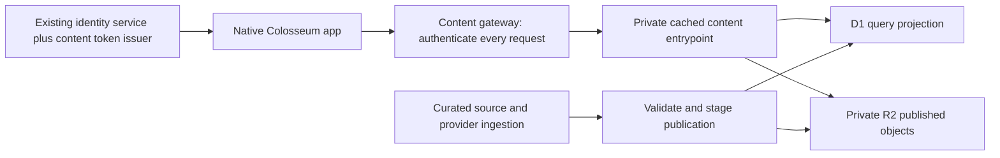

# Colosseum content API: infrastructure decision and action plan

Research date: 14 October 2026. Status: recommended architecture; not provisioned or runtime-qualified.

**Recommendation: use Cloudflare R2 Standard for published assets and versioned content documents, Workers for delivery, and benchmark D1 as the catalogue query store before adopting it.** R2 is a good fit for the object-serving part of this service. It cannot replace the query database. Keep an existing-style Go/PostgreSQL service as the concrete database fallback, behind the same HTTP contract.

The user's constraints are decisive: only Colosseum apps initially; all catalogue, Universe and Tribute content served through APIs; no client database downloads or post-release content-pack installation. Reading an image or JSON response transfers bytes normally, but never triggers a dataset sync or package installation. The native app owns rendering and interaction. User library, history and progress retain their existing ownership.

## Evidence from this checkout

Inspected source at HEAD `a4ed0f275e36bec430512444583ca62e787d8f3e`, plus read-only inspection of current data files. The checkout contains unrelated changes; they were not changed for this research. Counts below describe the working directory, including untracked assets, not an approved publication inventory.

| Surface | Observed size / records | Implication |
|---|---|---|
| IMDb | 21,528,576 bytes; 61,585 titles | Small enough to benchmark directly; not a complete global IMDb corpus |
| MAL | 41,381,888 bytes; 20,000 anime and 20,000 manga | Preserve medium and provider IDs; measure search and facet queries |
| Comics | 98,865,152 bytes; 22,710 series, 1,134 curated series, 398,427 mirror rows | Distinguish catalogue facts from source-resolution data; do not expose every table automatically |
| Tankoban | 2,850,816 bytes; 10,000 series, 28,839 volume records | Preserve volume synthesis and overlay behavior |
| Four databases combined | 164,626,432 bytes, approximately 165 MB | Capacity is not today's primary constraint |
| `assets/universes` | 146 files; 160,999,983 bytes | Asset optimization and lazy delivery matter immediately |
| Largest observed Universe asset | 8,789,112-byte PNG | Serving originals to every card would waste bandwidth and decode memory |

Relevant existing owners:

- `native/engine/CatalogVaultClient.*`: GitHub-release database download/update path; retire it for catalogue service delivery.
- `native/engine/{Imdb,Mal,Comics,Tankoban}Catalog.*`: synchronous SQLite reads and catalogue semantics; convert their UI seams to asynchronous service requests.
- `native/engine/BiblioCatalog.*` and `BiblioCatalogStore.*`: provider ingestion, ranking, provenance and snapshot semantics; migrate shared catalogue processing server-side rather than creating conflicting rules.
- `qml/Universes.js`, `qml/UniverseExtApi.js`, `assets/universes/*.json`: curation, extension identities and current payload validation. The existing payload cache assumes immutable bundled content.
- `qml/Main.qml`: separate bespoke Tribute and structured Universe routes. Preserve both.
- `native/engine/ColosseumTitleIdentityRegistry.*`: existing canonical `ct1:` identity and alias behavior. Do not mint competing identities.
- `server/account-service`: Go/PostgreSQL service exists in source. Current access tokens are opaque: `AuthenticateAccessToken` hashes the token and queries sessions/accounts/devices. A locally verifiable content token needs an explicit exchange/issuer addition. Existing source does not prove available production capacity.

Read-only `EXPLAIN QUERY PLAN` checks using Python's local SQLite showed `SCAN title` and a temporary ordering B-tree for the IMDb prefix-search predicate, and `SCAN manga` for the manga dual-title predicate. A movie rating shelf used `title_type_rating`. These are diagnostic query plans, not D1 latency or concurrency benchmarks. Imports must not blindly preserve the existing search access paths.

## Infrastructure comparison

| Option | Fit | Decision |
|---|---|---|
| R2 + Workers + D1 | Integrated object delivery and SQL API; low starting cost; SQL model needs qualification | Preferred candidate |
| R2 + Workers + separate Go/PostgreSQL catalogue service | Retains R2 benefits and familiar server stack; stronger escape route for complex search; adds an origin and its operations | Concrete fallback if D1 fails the benchmark |
| Bunny Storage/CDN + query backend | Strong dedicated asset-delivery alternative; still needs an API/database for catalogue semantics | Reserve asset-delivery alternative if measured latency or operational simplicity wins |
| S3 + CloudFront + query backend | Mature private-origin and delivery architecture; more AWS configuration and separate query services | Viable; no demonstrated advantage for this starting workload |
| Supabase PostgreSQL + Storage | Integrated SQL/auth/storage; could simplify a new application stack | Less compelling here because identity already exists and asset egress is metered |
| R2 objects alone | Works for fixed documents and artwork, not arbitrary catalogue filtering and search | Reject as the complete backend |

R2 Standard lists $0.015/GB-month, metered object operations and no R2 internet-egress charge. Its free allocation includes 10 GB-month, 1 million Class A and 10 million Class B operations monthly. Active delivery should use Standard rather than Infrequent Access, which has retrieval charges and minimum retention. [R2 pricing](https://developers.cloudflare.com/r2/pricing/).

Bunny's Standard CDN lists $0.01/GB in Europe/North America and $0.03/GB in Asia/Oceania, with a $1 monthly minimum. At 1 TB delivered entirely in Asia/Oceania, that is about $30 CDN bandwidth before storage and the API backend. Its Volume network has a different price/performance offering, so Standard rates are not a claim that Bunny is always more expensive. [Bunny pricing](https://bunny.net/pricing/).

AWS now offers CloudFront flat-rate plans, so an old comparison based only on expensive per-GB egress would be misleading. The current page lists a $15/month Pro plan with 10 million requests and 50 TB transfer allowance. A query backend remains separate; sustained excess can affect delivery under the plan's usage policy. [CloudFront pricing](https://aws.amazon.com/cloudfront/pricing/), [usage policy](https://docs.aws.amazon.com/AmazonCloudFront/latest/DeveloperGuide/flat-rate-pricing-plan.html).

Supabase Pro starts at $25/month; its pricing includes storage/egress allowances and meters overages, including cached egress at $0.03/GB. It remains a possible PostgreSQL host, without requiring Colosseum to adopt its identity system. [Supabase pricing](https://supabase.com/pricing).

This recommendation is based on product fit, current scale and documented pricing. No cross-provider latency test or account-level capacity audit has been performed; R2 has not been proven the fastest provider.

## Proposed serving architecture

Use a dedicated content service, independent of account/profile traffic. Suggested names are `content-api-staging`, `content-api-production`, `content-staging`, `content-production` and `content-source-archive`; actual names and domains must be checked before provisioning. Use a proposed `content.getcolosseum.world` hostname only after verifying DNS ownership/configuration. Disable public R2 bucket access and unintended Worker preview endpoints.

Use R2 bindings inside Workers. Apps never receive S3 credentials or raw source-snapshot URLs. R2 presigned S3 URLs do not work on custom domains; using them as the main app delivery route would bypass the intended gateway design. [Worker bindings](https://developers.cloudflare.com/r2/get-started/workers-api/), [presigned URL limitations](https://developers.cloudflare.com/r2/api/s3/presigned-urls/).

Choose an initial Asia-Pacific location hint when provisioning if the initial audience remains India-first, then measure cold reads. A location hint is not proof of an India location, jurisdiction guarantee, or globally replicated origin. [R2 data location](https://developers.cloudflare.com/r2/reference/data-location/).

### Query storage and search

Start with one dedicated D1 database per environment at this scale, with catalogue/revision columns and explicit indexes. Individual Universes do not require separate infrastructure databases. Keep source-specific facts and provider resolution records separate from the common work/alias projection. Build precomputed popular shelves and facet counts; do not calculate global aggregates on every screen request.

Use exact canonical/provider lookup first, then normalized aliases and tested prefix/full-text search. D1 supports FTS5, but a token-search replacement must preserve current title matching, punctuation, language and ranking behavior. Use keyset pagination with stable tie-breakers, bound values and allowlisted sorts/filters. Do not permit raw SQL, unbounded result sizes or an arbitrary URL proxy. [D1 SQL support](https://developers.cloudflare.com/d1/sql-api/sql-statements/).

D1 has a 10 GB per-database ceiling and serial execution within an individual database instance; throughput depends on query duration. Size alone therefore does not qualify it. Benchmark exact ID lookup, title/alias search, multi-facet filtering, deep paging, batch facts, book editions and Universe membership under concurrent load. [D1 constraints](https://developers.cloudflare.com/d1/reference/faq/).

Initial proposed acceptance targets: warm JSON p95 <=250 ms from the intended Indian client region; uncached JSON p95 <=800 ms; indexed query duration p95 <=25 ms; no timeouts at a 100-request/second mixed uncached test for 10 minutes. These are engineering targets, not measured results. Measure a US/EU client region too, record scanned rows, and change targets only explicitly with evidence. If indexing and precomputation cannot meet the gate, evaluate the same fixtures and API against a separate Go/PostgreSQL catalogue service before client migration.

Enable D1 read replication only with deliberate Sessions API handling. When activation publishes a new revision, first-primary reads or an activation bookmark must ensure replicas can serve it. Never interpret a lagging replica's missing new row as a permanent 404. [D1 replication and bookmarks](https://developers.cloudflare.com/d1/best-practices/read-replication/).

### Content model and contract

Core records: work, provider alias, edition/episode/volume, universe, membership/order, tribute, scene, asset and publication revision. Maintain existing canonical identity rules; store external numeric identifiers as strings in the wire format. A Tribute references its Universe; both reference common work IDs. Separate catalogue facts from changing provider availability and source resolution.

API v1 includes catalogue cards, paged items, filters, work details, bounded batch lookup, search, Universes, sections, Tribute descriptors, scenes and assets. Every collection has a revision and opaque next cursor. A cursor binds the content revision, normalized filters, sort and final sort tuple; invalid cursors return a defined error. Use an initial default page size of 24 and a maximum of 100.

Response envelope: `schemaVersion`, `revision`, `generatedAt`, `freshness`, `items` or `data`, and `nextCursor`. Errors include a stable code, retryability and request ID. Support conditional GET with ETags. Define 401/403, 404, 409 revision-expired, 429 with Retry-After, and 503 explicitly. A server failure must not masquerade as an empty catalogue.

### Tribute rendering and asset delivery

Extract curation and presentation parameters from JS/QML into validated server documents. Keep native renderer IDs such as `one-piece-atlas-v1`; serve only schema/capability combinations the app supports. Preserve current bespoke appearance, keyboard/controller behavior, reduced motion and title routing. New data and supported scene compositions publish without an app release. New executable behavior requires a compatible app release; no remotely executed QML/JavaScript.

Store published objects by content hash, for example `assets/sha256/<hash>/<variant>` and `tributes/<id>/<revision>/scenes/<scene-id>.json`. Return logical API URLs rather than bucket keys. Originals belong in the source archive; pre-generate only needed delivery variants, initially 320/640/1280/1920 widths where suitable. Test Qt decoding on each supported platform before choosing WebP; retain PNG for alpha/line art or JPEG where appropriate. Do not assume AVIF support. Keep map hotspot coordinates normalized so resizing preserves interaction alignment.

Fetch overview cards first, then the selected scene and visible assets; cancel requests for abandoned screens. Stream object bodies; never load a large asset into Worker memory. Implement and test HEAD, ETag/304, single byte ranges, Content-Range, 206 and 416. Arbitrary image-size parameters are rejected; allowed variants bound cost and cache cardinality.

### Authentication and caching

Reuse the existing account/session owner for signed-in issuance. Add a content-only token exchange rather than treating current opaque account tokens as JWTs. Proposed content leases expire after 15 minutes, contain audience/scope/expiry/key ID and are verified locally at the gateway. Rotate signing keys with an overlap. Account logout/revocation prevents renewal; ordinary lease revocation is bounded by expiry unless a separately tested immediate revocation check is added.

Account-free catalogue browsing uses a guest installation registration/renewal path with per-installation and IP limits. Reuse existing installation identity where applicable; an install ID is an identifier, not authentication proof. No shared secret is embedded in the binary. Guest issuance cannot cryptographically prove that all callers are official desktop binaries: the initial objective is controlled app integration and abuse resistance, not unbreakable exclusivity. Core local use does not require this service.

The gateway must execute before every cached response. Cloudflare now documents an uncached gateway plus cached internal entrypoint pattern. Disable caching on the public entrypoint itself, validate access, normalize requests, and only then invoke the private content entrypoint. Strip authorization/cookies before the internal call; cache only common catalogue data using revision, locale, visibility policy, renderer schema and normalized query as appropriate. Make the internal entrypoint unreachable directly. Rewrite outward headers to private caching policy where needed so downstream shared caches cannot bypass authentication. [Authenticated cache pattern](https://developers.cloudflare.com/workers/cache/examples/).

Qualify that recently documented cache feature in staging. The fallback is an uncached gateway using the established Cache API after authentication. That fallback has per-data-center caches and no automatic tiering; `cache.put` cannot store a 206 response. Stream uncached ranges or serve them from an already cached complete response. [Cache API behavior](https://developers.cloudflare.com/workers/runtime-apis/cache/).

Initial cache policy: bootstrap/active revision 30 seconds; revisioned catalogue pages 5 minutes; revisioned scene documents 1 hour; immutable asset representations up to a year internally. Keep 401/403/429/5xx out of the shared cache. Authenticate before cache lookup even for Range and HEAD. Token expiry and revocation tests must cover both cache HIT and MISS.

### Publishing, rollback and recovery

Build a publisher outside the request path, initially runnable locally and in CI. It extracts from explicitly selected source revisions, carries source/attribution and publication eligibility, validates identities/references, generates image variants, and writes an immutable manifest with hashes and row/object counts. Do not upload backups, untracked artwork, provider tokens or entire source tables indiscriminately.

Stage R2 objects and inactive SQL revision rows; verify all references and run API probes against the explicit candidate revision. Activate through a conditional update to a small D1 publication row only after validation. R2 and D1 do not share a transaction, so publication completeness is an application-level invariant. Serialize promotions or compare the previous revision to prevent two publishers from overwriting each other. Existing requests stay pinned to their revision.

Rollback selects a retained complete revision. Keep at least two known-good releases and a proposed minimum 30-day retention, extending it for any supported client or live cursor requirement. Garbage collection follows manifest references and a grace period; an age-only lifecycle must never delete an active shared asset. Expired cursors explicitly restart paging rather than mixing revisions.

Retain canonical exports, import scripts and hash manifests outside the serving database, plus a separate recovery copy outside the production account. Do not rely on D1 SQL export alone when FTS5 is present: current documentation lists export limitations for virtual tables and blocking during export. Treat FTS indexes as reproducible; prove recovery from canonical data into an empty environment. [D1 import/export limitations](https://developers.cloudflare.com/d1/best-practices/import-export-data/).

### Client migration and offline behavior

Extend existing native catalogue owners with a shared asynchronous transport and models; QML remains presentation. Add request generations, cancellation, bounded retries/backoff, coalescing and a small visible-content prefetch budget. Avoid synchronous HTTP hidden behind old SQL-returning methods.

Reuse existing HTTP/image cache ownership where possible. Cache previously requested data with bounded eviction; do not silently rebuild a full local catalogue. Preserve enough metadata attached to saved library items for local browsing, identification already performed, history and resume. New catalogue discovery and uncached assets require connectivity. Keep local-library search distinct from remote catalogue search. Test account changes so personalized data cannot leak through shared content caches.

Retire production `CatalogVaultClient` fetching only after all affected catalogue journeys have service replacements. Old installed app versions remain an explicit compatibility issue; this plan does not silently redirect their database URLs to an incompatible JSON API. The new release must have zero catalogue DB/content-pack fetches.

## Cost model and operations

Planning assumptions, not a forecast: 30-day month; two sessions per daily active user; each session requests 12 JSON responses and 40 assets; 80% JSON and 90% asset edge-cache hits; 20 GB total R2 Standard content including retained revisions; D1 <=5 GB; publisher writes stay inside included quotas. Assume average total Worker CPU per incoming request of 2-7 ms, including authentication. Account-level included allowances are assumed unused by other services.

| Model | Monthly JSON + asset requests | Workers + R2 + included D1 estimate |
|---|---:|---:|
| 1,000 daily active users | 3.12 million | about $5.15/month |
| 10,000 daily active users | 31.2 million | about $12.16-$15.28/month |

Formula: Workers $5 + max(0, requests-10M)/1M * $0.30 + max(0, CPU-ms-30M)/1M * $0.02; R2 storage (20-10) * $0.015. R2 reads remain below 10M in this scenario even if every JSON cache miss also reads an object. At 10,000 DAU, 1.44M uncached JSON calls scanning an assumed 100 rows each consume 144M D1 rows read. This assumption must be replaced with measured scan counts; rows returned are not rows billed. [Workers pricing](https://developers.cloudflare.com/workers/platform/pricing/), [D1 pricing](https://developers.cloudflare.com/d1/platform/pricing/).

At an assumed average 100 KB asset, those models deliver about 240 GB and 2.4 TB of asset bytes. Origin egress is free on R2, but client bandwidth, latency and decode costs remain. Counts exclude token issuance/renewal, failed requests, retries and extra round trips; add these to the measured production model. The dollar estimates also exclude existing account-service hosting, CI, domains, taxes, paid image transformations, extra observability, WAF add-ons and independent backup storage. Cache hits still reach the authentication gateway and are not free Worker requests.

Use pre-generated image variants initially. Do not add Images, Stream, KV, Queues, Vectorize or a separate search engine until workload evidence justifies them. Add a video platform if actual Tribute media needs transcoding/adaptive streaming; R2 does not create renditions.

Monitor p50/p95/p99 latency by route/region, cache hits, R2 operations, D1 scanned/written rows, Worker CPU, returned bytes, error rate, token failures, stale revision use and publication failures. Sample logs and redact credentials. Set per-route input/body limits, CPU limits, publisher write caps and budget alerts; alerts alone are not a hard spending cap. Rate-limit catalogue enumeration and token issuance without blocking ordinary image bursts. Retain a rollback switch and a verified restore procedure.

## Action plan and acceptance gates

| Step | Concrete work / suggested location | Exit evidence |
|---|---|---|
| 1. Freeze contracts and inventory | OpenAPI, JSON schemas, route/query map and source manifest under a proposed `server/content-api/`; record every current caller and canonical ID rule | Each existing catalogue operation mapped; eligible assets/source ownership known; no automatic inclusion of dirty work |
| 2. Build query qualification fixture | Read-only exporters and representative query fixtures under proposed `tools/content-publisher/` and `server/content-api/tests/` | Search/filter/order results match selected existing fixtures; query plans avoid unjustified scans; canonical identities unchanged |
| 3. Local vertical slice | Worker gateway, internal content handler, local D1/R2 simulation; one catalogue page plus One Piece overview and one sea | No DB/package client transfer; async loading/cancellation; schema and cursor tests pass |
| 4. Provision staging when R2/account setup is available | Confirm account, paid plan, DNS, location hint; create isolated staging bucket/database/Worker and scoped publisher credentials | Real Worker binding, private bucket, authenticated cache HIT/MISS, Range/304, token expiry and origin-bypass probes pass |
| 5. Decide D1 with measured load | Run the mixed query benchmark and regional latency probes; compare Go/PostgreSQL if D1 misses targets after bounded tuning | Recorded latency/concurrency/scan results meet agreed gates; chosen backend and revised cost sheet documented |
| 6. Build publication lifecycle | Stage candidate data/assets, validate, activate, roll back, restore into empty staging | Failed/partial publication never activates; concurrent publish and replica lag covered; rollback restores complete experience |
| 7. Migrate native catalogue clients | Existing engine owners and QML callers; start IMDb, then MAL/Tankoban/comics, then Biblio ingestion/ranking | Search, filtering, infinite scroll, work routing, local-library behavior and provider-outage cases pass per domain |
| 8. Migrate Universes and Tributes | Existing extension payload seam and all bespoke/template pages; extract each scene's data/assets | One Piece, DCAU, Star Wars, Cosmere and remaining roster have mapped content dependencies; visual/input parity; unsupported renderer behavior verified |
| 9. Production rollout | Separate production resources, staged client rollout, recovery copy, monitoring and budget limits | Fresh install uses API only; content publication appears without reinstall; no catalogue updater/background pack fetches; outage and token-renewal tests pass |

Steps 1-3 can begin before R2 is enabled. Steps 4-6 establish the real infrastructure evidence before broad client conversion. Production work follows only after those gates. This document authorizes no purchases or deployments by itself.

Proposed completion criteria: content updates are visible within 60 seconds of activation under healthy conditions; no mixed-revision scenes/pages; no unauthenticated cache bypass; local media/history/resume work during a service outage; backend latency meets the qualified targets; all existing catalogue operations have explicit replacements; no unexplained provider or identity changes. These are targets to prove, not current claims.

## Remaining decisions and evidence limits

The recommendation selects R2 for objects and a D1-first qualification path. Hosting account state, available plans/quotas, DNS readiness, real regional performance, intended DAU/traffic, complete externally hosted asset inventory and existing account-service capacity remain unverified. Those affect provisioning and estimates, not the API-only contract. No infrastructure resources, credentials, application code or source databases were changed during this research.
