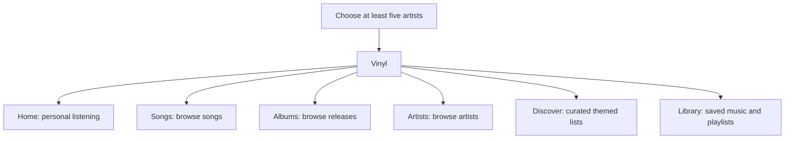

# Vinyl: Product Blueprint and Experience Specification

- Date: 2026-11-03
- Status: Draft for Hemanth's written review
- Purpose: Define the Vinyl experience that technical research and development must deliver.

This is the product specification, experience design and navigation blueprint in one document. It records the agreed direction; it does not claim that every capability already exists. It does not select an algorithmic foundation, live catalogue/enrichment databases, APIs or a backend architecture, and contains no public-API feasibility assessment. GPT-6 Pro owns that research and the subsequent technical recommendations.

## 1. Product intent

Vinyl is Colosseum's complete music experience: finding music, exploring a broad catalogue, building a personal Library, receiving useful recommendations and listening in a dedicated song room. Its interface retains Colosseum's existing QML identity and conventions.

The catalogue extends beyond the artists chosen during onboarding. Personalization helps people find more music; it does not fence them into their initial selections.

Music is the scope. Podcasts and audiobooks are outside this Vinyl blueprint. The separate discussion of podcasts in Biblio remains deferred.

## 2. The main map

There are six primary destinations, in this order:

**Home · Songs · Albums · Artists · Discover · Library**

The main search icon is a shared entry point, not another primary tab. Song, album, artist and playlist detail pages open from these destinations and return to the context that opened them.

Each destination preserves its own browsing position, filters and sorting. Back navigation restores the preceding context. A detail visit or playback action must not unexpectedly replace another destination's content or reset its browsing state.

### The responsibility of each destination

| Destination | What a person comes here to do | What belongs here |
| --- | --- | --- |
| Home | Decide what to listen to now | Continue listening, personal spotlights, familiar music, artist releases, mixes, radio and discoveries informed by taste and listening |
| Songs | Explore songs without needing a search first | A populated song catalogue with category-appropriate filters, sorting and pagination |
| Albums | Explore albums and releases | A populated release catalogue with filters, sorting, release context and pagination |
| Artists | Find and explore artists beyond existing favourites | A populated artist catalogue with relevant filters, sorting and links to artist pages |
| Discover | Explore a musical idea or unfamiliar area | Deliberately curated lists organized around a theme, era, scene or style |
| Library | Organize and play music the person has chosen to keep | Saved songs, saved albums, followed artists and personal playlists |

## 3. Onboarding and artist tastes

The first Vinyl visit requires at least five artist selections. There is no Skip route into Vinyl's music destinations. Selecting more than five is allowed.

The artist picker has its own dedicated artist-search field. It is not redirected into the general search screen. Leaving Vinyl for another world remains possible during onboarding.

After onboarding, Your Artists provides a route back to the picker to edit or add taste selections. Confirmed selections remain available across restarts. Cancelling an edit preserves the previous selections; confirming an edit retains the minimum of five.

Taste selections and following an artist in Library are distinct actions. Picking an artist for recommendations does not automatically follow that artist. These memberships do not silently modify one another.

## 4. Home and recommendations

Home is a personalized listening starting point. It brings together:

- Recent unfinished listening and familiar music worth returning to.
- Releases from artists the person likes.
- Song, album and artist spotlights.
- Generated mixes and ongoing radio, in separate sections.
- Discoveries beyond the original artist picks.
- Rediscovery and less-played music informed by listening and saved music.

Listening history and explicit recommendation feedback gradually shape Home. A recommendation response and a Library save are separate actions.

Retain the Home Refresh and Add Artist actions. Artist editing uses the dedicated picker. The removed recommendation-configuration panel is not part of this Home design.

Broad recommendation rows should contain a useful variety of artists and albums. Several tracks from the same album, repeated editions or recurring identical selections must not dominate general-purpose rows. An explicitly artist-specific or album-specific list can naturally have a narrower focus.

See all opens the corresponding larger listing. It must offer meaningful depth and continuation instead of exposing only the same small Home preview.

Library remains the destination for organizing the person's saved music. Home can use saved music as a listening signal without becoming a duplicate Library browser.

### Carousel decisions carried forward

The carousel has five manually navigated positions. It mainly uses individual spotlights, with an occasional paired discovery.

A recent unfinished listening session has a 72-hour eligibility window for the opening resume spotlight. When no session qualifies, the opening position is a curated personal spotlight. The other positions are dynamically curated. The selection refreshes daily and can also be refreshed on demand. Refreshing should produce useful rotation rather than repeatedly presenting the same items.

The personalized carousel and recommendation rows retain Colosseum styling. A spotlight's action describes its destination or action, such as opening an album or artist, rather than using an unexplained arrow.

### Mixes and radio

| Mixes | Radio |
| --- | --- |
| A generated, finite tracklist that can be inspected and played | A listening stream that keeps finding more music as playback continues |
| Presented with the approved cassette treatment and song-cover inserts | Presented with the approved radio treatment and artist imagery |
| A generated mix is distinct from a user-authored Library playlist | Radio continuation remains distinct from a fixed playlist |

The system should support useful variety and related discoveries, rather than simply repeating one selected artist's catalogue under a radio label. Algorithm selection and the live information needed to produce these behaviours belong to Pro's research.

## 5. Songs, Albums and Artists: browseable catalogue pages

All three catalogue destinations open populated. A person can explore immediately without first knowing an artist's name or entering a query.

These pages reuse the other worlds' browsing pattern: the established QML layout, sidebar filters, sorting and navigable content. The entity categories have their own relevant controls instead of sharing one generic set of filters.

The desired browsing dimensions include artist, genre/style, era or release period, language and explicitly selected region where relevant. Albums need release-oriented browsing; songs need track-oriented browsing; artists need artist-oriented browsing. The researched system must supply the information that makes the chosen controls meaningful.

Filters apply to the catalogue query and its subsequent pages. They must not merely filter the small set of cards already loaded. Sorting applies consistently through that result set.

A person can combine a browsing choice with relevant filters, change ordering and continue into more results while retaining the selected criteria. Returning from a detail page preserves that context.

### Charts, rankings and region

Charts are deliberate destinations or browsing choices. A Billboard album chart and a Billboard song chart are different lists. A popularity ranking and a commercial/sales ranking also measure different things.

Every chart or ranking identifies what it measures, its source and the applicable period and territory. Regional controls identify what the region describes, such as a chart market or artist origin.

Region is chosen explicitly. Neither catalogue landings nor Discover become an automatic popular-near-you feed based on location, device locale or an inferred country.

Pro must research the live information needed for these browsing and ranking behaviours. An unavailable data source is a requirement gap to report and resolve with Hemanth, not permission to silently relabel another metric or remove the intended behaviour.

## 6. Discover: curated musical exploration

Discover is organized around a musical idea rather than a personal listening profile. Examples already discussed include Classic East Coast Hip-Hop and 80s Classics.

Each list contains intentionally selected music relevant to its theme. A person opens the list, explores its entries, visits the corresponding detail pages and can listen to or save the music.

Discover is distinct from both Home's personalized selection and the general-purpose catalogue tabs. Its identity comes from the quality and coherence of the list, not a large undifferentiated grid of items or automatic regional charts.

The source of curated lists, their supporting databases and any enrichment process are research questions assigned to Pro. This document does not preselect a curation source.

## 7. Library, Collections and Vault

These are separate product responsibilities.

| Surface | Responsibility |
| --- | --- |
| Vinyl Library | Saved songs, saved albums, followed artists and personal playlists; organization and playback |
| Colosseum Collections | Cross-world personal groupings that may contain music alongside other media |
| Vault | Imported music, importing, local files and file management |

**Imported music stays in Vault.** Vinyl Library does not gain an importer, music-folder manager or a parallel local-file store. Existing Vault ownership must be preserved when technical work is planned. This blueprint does not change existing cross-world visibility or playback routes for Vault content.

A song or album can have Library membership and Collection membership without either replacing the other. A playlist is a music playback sequence; a Collection is a cross-world grouping.

Library supports finding saved music, opening its details and playing it. Personal playlists support creation, editing, track organization and playback. Saved state and playlist changes remain available when the person returns or restarts the app.

Home's Your Artists taste-editing route and Library's followed artists remain distinguishable. The Library's Artists section must not silently become a second presentation of onboarding selections.

## 8. Search and detail journeys

General music search opens from the main search icon and covers songs, albums, artists and public playlists. The dedicated favourite-artist search remains the explicit exception.

Search has a readable loading state, useful results, pagination and a clear return path. Loading must not present awkwardly positioned empty category headers as though final zero-result groups had already been established.

The principal journeys are:

| Starting point | Journey |
| --- | --- |
| Songs | Browse or filter -> song -> play, save or add to a playlist/Collection |
| Albums | Browse or filter -> album -> track -> listening |
| Artists | Browse or filter -> artist -> releases or songs -> listening |
| Discover | Curated list -> entry -> detail -> listen or save |
| Library | Saved music or personal playlist -> detail or playback |
| Search | Matching song, album, artist or public playlist -> corresponding detail and playback flow |
| Home | Continue listening, a spotlight, a mix or radio -> the appropriate listening or detail experience |

Collaborating artists remain separate artist identities with separate destinations. A joined display credit must not become an invented single artist.

The persistent HUD represents the actual playing song even while another item is being browsed. Opening another detail page does not silently switch playback.

## 9. Preserve the approved listening experience

The dedicated song room and the playback work already accepted by Hemanth are the baseline, rather than a new redesign brief:

- Large central artwork with lyrics on the left and manual Genius annotations on the right, aligned at the cover's top edge.
- One compact glass HUD with a long timeline, clear transport, queue, video control and joined YouTube/Tankorent source tabs.
- The three-icon shell dock hides only on the song page, allowing the HUD to centre beneath the cover; leaving that page restores it.
- YouTube is the default remote playback choice; Tankorent selection is explicit.
- Video remains available through the persistent HUD. Lookup retains the current page and audio; successful entry opens the song room already in video mode, without an intermediate cover screen.
- Cancelling a video lookup or navigating elsewhere prevents a late result from stealing the destination.
- Ordinary video stays above the fixed HUD. Explicit fullscreen alone expands and auto-hides controls.
- Video Back mirrors fullscreen at the opposite outer corner. Returning to audio restores the large cover and the existing reading layout.
- Saved-song, playlist and Collection actions retain their distinct purposes.

Manual Genius annotations already work. Auto-annotations remain deferred. The Credits feature remains removed for now; legitimate source and contributor attribution is preserved.

This specification does not require annotations to remain visible during a music video.

## 10. Visual and interaction language

Reuse the existing Colosseum QML and shared world conventions. Preserve the shared wallpaper and approved glass presentation instead of treating Vinyl as a separate visual product.

| Content type | Approved treatment |
| --- | --- |
| Song | Uniform jukebox-style card preserving the full cover and the approved caption treatment |
| Album | Closed, visibly transparent jewel case with a readable physical rim/spine; no protruding record or CD |
| Artist | Approved framed black record with the artist photograph; no centre dot obscuring the face |
| Mix | Cassette incorporating song-cover imagery |
| Radio | Enlarged radio widget incorporating artist imagery, with the approved neutral metal/black/grey direction |

Cards must remain usable in dense catalogue browsing. Detail artwork stays large on desktop. Different entity treatments and their existing interactions remain consistent across destinations.

Controls use the established symbols and explicit page actions. Preserve the approved subtle hover tick/X recommendation feedback. Context menus, cyclic menus and hover-description popups are outside the interaction model. Clear inline loading and error messages remain appropriate.

## 11. Loading, failure and continuity

Each destination has coherent loading, empty and failure states. Available content remains useful while more results are requested. Failed or stale work must not replace a newer query, another profile's content or the song the person actually selected.

Library state remains personal and durable. Cached catalogue information is distinguished from a failed refresh, and expired playback locations are not presented as available offline music. The implementation strategy for these behaviours is left to technical planning.

## 12. GPT-6 Pro's research assignment

**Find the underpinning algorithmic system and live databases/enrichment sources that can produce the experience in this blueprint.**

Pro owns all investigation of available algorithms, databases, APIs, data coverage, access conditions, reuse/licensing constraints and feasibility. Codex has not performed that research for this document and has not preselected the answer.

The requested research output is:

1. A recommended established algorithmic foundation for Home recommendations, mix generation, radio continuation, learning and useful variety.
2. Recommended live catalogue and enrichment sources supporting the required entity pages, filters, rankings, releases, relationships and curated exploration.
3. A mapping from each product behaviour to the proposed underlying systems and information.
4. Explicit gaps, tradeoffs and alternatives wherever the desired behaviour cannot yet be supported as specified.
5. A concrete technical course and sequenced development steps toward this blueprint, including reuse of Colosseum's existing owners and the evidence needed to accept each slice.

Existing implementation is material to assess and reuse, not proof that a requirement is finished. The research must not silently redesign the product to fit the first convenient service or move Vault responsibilities into Vinyl.

Research and recommendations come first. Application implementation, dependency adoption, data migration and release changes require the subsequent agreed development plan.

## 13. Product acceptance checklist

The future implementation must let Hemanth confirm the following in the actual app:

- All six destinations exist and serve the distinct purposes in this document.
- Songs, Albums and Artists can be browsed immediately, beyond the five taste picks, without an initial search.
- Filters, sorting and pagination form one coherent browsing result set, with meaningful depth behind See all.
- Home uses personal taste, listening and feedback while introducing varied music beyond the initial picks.
- Discover contains coherent themed lists and does not default to inferred regional trends.
- Library supports saved music, followed artists and personal playlist organization/playback, with retained state.
- Taste picks, followed artists, Library membership, playlists and cross-world Collections retain their distinct meanings.
- Imported music, importing and local-file management remain in Vault.
- General search and the dedicated artist picker remain distinct, usable flows.
- Mixes are finite playable tracklists; radio continues finding music; Home presents them separately.
- The approved song room, manual annotations, persistent playback and direct video journey remain intact.

Review of this document approves the intended product experience. It is separate from Pro's technical research, implementation verification and release acceptance.